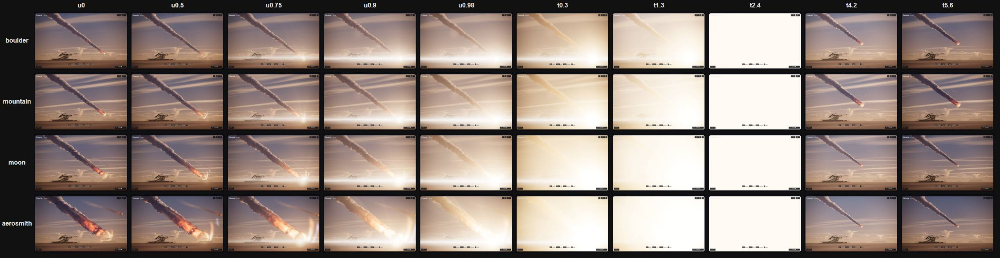
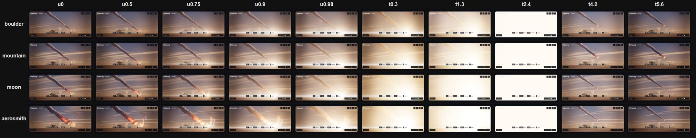
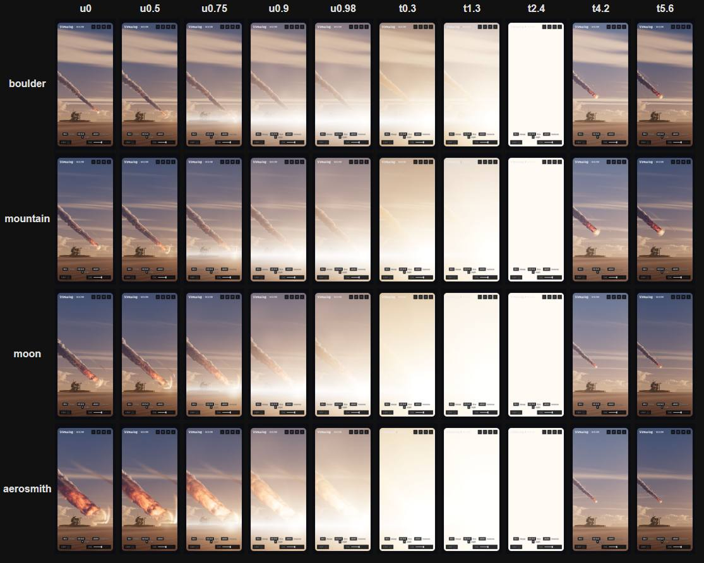

---
# stimming-hsym
title: 'Railgun: game over, an unshot rock strikes the planet'
status: completed
type: task
priority: normal
created_at: 2026-11-12T09:26:45Z
updated_at: 2026-11-12T09:58:00Z
parent: stimming-f793
---

An unshot rock no longer holds. It falls at one speed from first sight into the ground. On its last stretch the ground glows, god rays and the blast come from the impact point, an anamorphic streak rides the rock's face down, and the surge climbs. At contact the frame burns to white. Under the white the toy cuts to a fresh start, as Reset does. Branch: `claude/railgun-game-over-6e5171` (Tom merges).

## Checklist
- [x] Timing: no hold, one speed, fair window recorded (docs/plans/railgun.md, Game over)
- [x] Strike: the rock falls on its track to the ground at one speed, per size
- [x] Impact glow, god rays, blast effects, anamorphic streak, white burn
- [x] Surge is the game-over sound: it grows with nearness, peaks at contact, dies in the white
- [x] Bow shock grows larger and wider, with a violet outer shell
- [x] The rock's glow lights near heaps and the storm tower (`uRockL`)
- [x] White-out cuts to a fresh start through landReset
- [x] A bolt that lands before contact saves the planet
- [x] Dev rows: Fast rock (10x fall), Strike test (start at the horizon line)
- [x] Reduced motion, mute, hidden tab
- [x] QA: every size, 1280 x 800, 375 x 812, 812 x 375, clean console, 30 fps
- [x] Stills of the beats in the bean

## Timing

The strike runs from the horizon line (`s = 1`) to contact (`s1`). `u` is the rock's nearness to the ground, 0 to 1.

| Rock | Strike time | Whole fall from a fresh start |
|---|---|---|
| Boulder | 67 s | 3 min 52 s |
| Mountain | 86 s | 5 min 11 s |
| Moon | 99 s | 6 min 24 s |
| Aerosmith | 80 s | 7 min 50 s |

A kill takes about 22 s, so the whole fall is the fair window. After contact: a 2.6 s burn to white (4.2 s with reduced motion), 0.7 s of white, then Reset's fill.

## Stills

Columns: `u` = nearness to the ground; `t` = seconds after contact. `t4.2` and `t5.6` show the fresh start.

## Summary of Changes

- `railgun/index.html`: the hold is gone; `stepAst` runs one speed to contact; new strike section (`contactS`, `startStrike`, `stepStrike`, `strikeHit`, `endStrike`, `updateStrike`). `humUpdate` takes a drive object, so the surge reuses the charge sound. The bow takes `uGrand`. Clouds take `uRockL`. `fire()` and the aim lead past the horizon line; a bolt landing after contact flies wide. `landReset` clears the strike and the old hit clock. Dev rows Fast rock and Strike test. QA hooks `strike()`, `strikeAt(u)`, `fast(on)`, `strikeState()`.
- `docs/plans/railgun.md`: the Game over section.
- QA (headless Edge): 12 runs, console clean; 30 fps through fall, burn and fresh start; the hidden tab freezes the fall and suspends the audio; reduced motion plays a gentler burn; a shot mid-strike shatters the rock.
- The main session knows about `uRockL`: the clouds session edits `CLOUD_FS` too, so a small merge may follow.
