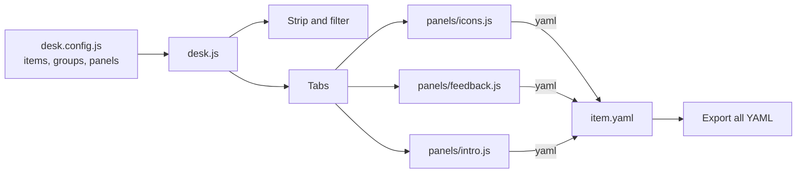

# The desk: a template

Status: active · bean `stimming-9ex4`

The desk walks a list of items, one at a time. Each item gets the same panels as tabs, and one YAML file that holds every panel's work on it.
Stimming's desk (`accesslab/index.html`) has four panels for each toy: Icon, Feedback, Intro, Share. The access kit (`access.html`) is a separate page.

Copy this folder for another project. Change the config, keep the core.

## Files

| File | Role | Project-specific |
|---|---|---|
| `index.html` | The page: chrome slots, the sprite, then `desk.js` | No |
| `desk.js` | The core: items, strip, filter, tabs, YAML, keys | No |
| `desk.css` | Tokens and Bar v3 words | Tokens only |
| `yaml.js` | A small YAML writer for plain data | No |
| `desk.config.js` | The items, the groups, the panels, the head line | Yes: the one file to replace |
| `panels/<id>.js` | One panel each | Yes |
| `glyphs.js`, `access-data.js` | Stimming's access glyphs and data | Yes |
| `hub.json` | Toy folders that `toys.json` lacks; `node tools/hubdata.mjs` writes it | Yes |



## The config

`desk.config.js` exports one object:

| Key | Holds |
|---|---|
| `project`, `title` | Names. The export file is `<project>-desk.yaml`. |
| `storage` | The key prefix for the desk's own state: item, tab, filter, panel state. |
| `root` | The path from the desk to the site root. |
| `links` | Pages beside the desk: `[label, href]`. |
| `groups` | Strip groups in order: `[id, label]`. The filter offers each, then Untouched. |
| `panels` | Panel ids, in tab order. Each loads from `panels/<id>.js`. |
| `first` | The item a bare address opens. |
| `items()` | Async. Returns `{ id, name, group, sub, emblem, accent, raw }` per item. |
| `ink(item)` | The item's colour; the core sets `--acc-ink` from it. |
| `facts(item)` | HTML for the line under the name. |

## A panel

A panel is a module with a default export:

```js
export default {
  id: 'notes',            // the tab's id, the YAML key
  label: 'Notes',         // the tab's word
  async setup(desk) {},   // once: load data, add its CSS, attach listeners to desk.$('panel')
  mount(host, item, desk) {}, // draw for one item
  unmount() {},           // stop work before the next item or tab
  status(item, desk) {},  // a short word on the tab, or ''
  yaml(item, desk) {},    // this panel's part of the item's YAML; null when untouched
};
```

Rules that keep a panel cheap to change:

1. One panel, one concern. Its data, its CSS and its listeners stay in its file.
2. Attach listeners once, in `setup`, on `desk.$('panel')`. The host persists between items; listeners added in `mount` pile up.
3. Never name a constant `CSS`: it hides the browser's `CSS.escape`. Use `STYLE`.
4. Save through the store the work belongs to (the icon sheet's keys, the inventory record). Call `desk.refresh()` after a save, so the tab word and the strip dot follow.
5. `yaml()` returns only what a fix needs, and `null` when the item has no work. The desk counts an item as touched when any panel returns data.
6. A step that deletes asks first, in place, and offers Undo (`desk.toast(text, undo)`).

## The desk handle

| Member | Does |
|---|---|
| `desk.item`, `desk.items`, `desk.byId` | The current item and the list |
| `desk.go(id, tab?)` | Opens an item |
| `desk.refresh()` | Redraws the tab words and the strip dots |
| `desk.keep.get(k, d)`, `desk.keep.set(k, v)` | The desk's own state, under `storage` |
| `desk.toast(text, undo?)` | A note at the foot, with Undo |
| `desk.words(opts, attr, on)` | Bar v3 words |
| `desk.yamlOf(id)`, `desk.download(name, text)` | The YAML of one item; a file save |

## The YAML

One document per item. The core writes `id`, `name`, `group`, then one key per panel that has work:

```yaml
id: fireworks
name: Fireworks
group: main
icons:
  pick: A
  votes:
    a@fireworks-2: keep
    e@17: cut
feedback:
  verdict: polish
  needsWork:
    intro: Row sits too low
intro:
  verdict: needs work
  note: Row sits too low
  seenWith: { effect: signal, layout: stack, calm: false }
```

Export all writes `project`, `date` and `items:`, one entry per touched item. Hand the file to the agent that makes the fixes; it is the brief.

## Stimming's panels

| Panel | Reads | Writes |
|---|---|---|
| Icon | `icons/sheet.html` (GALLERY), `icons/rounds.json`, `icons/picks.json`, `icons/history/menu.json`, `icons/index.html`, the menu | `stimming.icons.marks`, `stimming.icons.cuts`: the sheet's keys |
| Feedback | All of inventorylab, ported: the toy, its stack, its logos, the full schema-2 form, the overview; `docs/inventory/*.json` (dev server), `series.json`, the menu | `stimming.inventory.<id>`; Save file writes `docs/inventory/<id>.json` |
| Intro | `shared/intro.js`, `toys.json`, `access-data.js` | The inventory record's `intro` area; `stimming.desk.intro.<id>` for the look it was judged in |
| Share | `share-card.js`: `toys.json`, the emblem, the still, the menu wordmark, `access-data.js` | Nothing |
