# Ascent: clean-up, a striking look, one flight with Ten seconds

A Lab toy (`ascent/`). A rocket flies from a dawn pad to deep space on cameras fixed to its hull. The probe it carries parts, opens its wings and coasts on alone.
Bean: `stimming-ng4g`. In the Lab since PR #58 (2026-11-14). Today it is a blockout.

## Decisions so far (Tom)

| Date | Decision |
|---|---|
| 2026-11-10 | Look: Photoreal. The spike stays at `ascent/looks.html`. |
| 2026-11-10 | The flight plays itself; the viewer cuts cameras. Static hull mounts, Dutch angles. |
| 2026-11-10 | The end: a probe opens its wings and coasts on, cosmic and lonely. |
| 2026-11-10 | Ascent is its own toy, not Act 2 of Ten seconds. |
| 2026-11-14 | Clean it up, make it striking, and connect it with Ten seconds. Ten seconds gets its own session. |
| 2026-11-14 | The link is the menu only: Ascent joins the After dark series. No jump between the pages. |
| 2026-11-14 | One shared rocket for both toys, in `shared/rocket.js`. |
| 2026-11-14 | Yes to the public-domain Blue Marble Earth map, about 3 MB at 4K, for the far shots. |
| 2026-11-14 | The flight stays about 7 minutes. |

## 1. Goals

1. **Two toys, one world.** Ten seconds is the ground: the wait, the light, the roar ten seconds late. Ascent is the ride. Both fly the same rocket at the same kind of dawn, and the menu links their tiles.
2. **Every cut is a still worth keeping.** Each phase has one hero shot, built and signed off on its own.
3. **Clean parts.** One rocket, one flame, one sky model, shared where both toys need them.

## 2. The story and its hero shots

```mermaid
flowchart LR
  A[Ten seconds<br/>tripod, marsh, roar] -.->|After dark series| B[Liftoff<br/>engine cam]
  B --> C[Dawn climb<br/>lit plume]
  C --> D[Sunstrike<br/>hull turns gold]
  D --> E[Max-q<br/>vapour collar]
  E --> F[Staging<br/>stage falls, ice]
  F --> G[Fairing<br/>probe revealed]
  G --> H[Orbital sunrise<br/>limb, starburst]
  H --> I[Escape<br/>full Earth]
  I --> J[Probe<br/>wings open]
  J --> K[Coast<br/>Earth and Moon as two dots]
```

| # | Shot | What makes it | Today |
|---|---|---|---|
| 1 | Liftoff | Engine cam: pad lights, steam rolling out, the tower falling away, the marsh below | Black ground, a ball of flame |
| 2 | Dawn climb | The plume high up catches the hidden sun: a glowing jellyfish on deep blue | Missing |
| 3 | Sunstrike | The first sun hits the hull: gold paint, a flare streak, a hard shadow | Happens, unstaged |
| 4 | Max-q | A vapour collar around the body, shake, streaks racing down | Faint streaks |
| 5 | Staging | The first stage falls back and turns; RCS puffs; ice lit gold; the vacuum bell glows | Works, plain |
| 6 | Fairing | The halves peel away; the probe in gold foil; the limb beyond | Works, plain |
| 7 | Orbital sunrise | The thin blue and orange limb; the sun breaks it with a starburst | Flat blue haze |
| 8 | Escape | The whole Earth in frame: clouds, sea glint, the terminator, towns on the night side | Good start |
| 9 | Probe | The wings unfold panel by panel and turn to the sun | Works |
| 10 | Coast | A wing in front, the Earth a mote, the Moon a smaller one, the Milky Way rising | Works, sparse |

## 3. The link with Ten seconds

Tom's pick: the menu link, plus a shared rocket. The pages do not jump to each other.

| Part | What it does | Who builds it |
|---|---|---|
| Same series | Ascent joins After dark (`dark` in `toys.json`). Hover on either tile lights the other. | This session |
| Same rocket | `shared/rocket.js`: one model in Small, Medium and Heavy, with the flame (tail and end-on disc). | This session builds it in Ascent first; the Ten seconds session adopts it |
| Same pad | Ascent's ground near the pad reads like Ten seconds: reed marsh west, the pad on the far shore, sea east. | This session, from the layout the Ten seconds session writes down |
| Same sound | Both use `launch/thrust.mp3` through the same roar chain. | Both |
| Same dawn | Ascent's Dawn row starts at Ten seconds' default (0.4). | This session |

## 4. Visual work, by layer

### Earth and air (`ascent/space.js`)

- Multiple scattering, approximated, so twilight skies hold colour, not black.
- A cloud shell above the ground: parallax, self-shadow, shadows on the sea and land.
- Sea: glint widened by wind, darker deep water, bright shallows at coasts.
- Land: biome colours by latitude, coasts that read from orbit, rivers as thin dark lines.
- Night side: towns along coasts and roads, not noise.
- A real Earth map for the far shots: NASA's public-domain Blue Marble at 4K (Tom said yes). Near shots stay procedural; the two blend by distance.

### The plume

- A raymarched plume at kilometre scale in the backdrop pass: a cone that blooms into the jellyfish above 30 km.
- Lit by the sun with the Earth's shadow, so it glows while the ground is dark.
- The near trail stays as puffs; it hands off to the far plume by distance.

### Rocket (`shared/rocket.js`)

- Profile: stringers, panel seams, cable raceways, a black interstage with ribs, grid fins, RCS pods.
- Frost bands on the oxygen tank that flake off in the first minute.
- Soot that creeps up the aft skirt over the burn.
- The camera housings on the hull, so each shot shows its own mount.

### Probe (`ascent/probe.js`)

- Foil with a crinkle normal map, a feed horn in the dish, a star tracker, thruster nozzles.
- A stencil and a small flag; a label with the probe's name (Tom names it).

### Camera and grade

- Lens dirt that lights up with the sun.
- Auto exposure with lag: the frame blows out at the sunstrike, then settles.
- Rolling-shutter wobble at max-q; sensor grain that rises in the dark.
- Cuts get a one-frame shutter blink; the mount settles after each event.
- Shared modules: `shared/flare.js` (streak), `shared/grade.js` (tint, vignette, grain).

### The porthole camera

- A crew-style porthole with `shared/wetglass.js`: rain at liftoff, frost by 20 km, clear in vacuum.

## 5. Sound

| Phase | Layer |
|---|---|
| Liftoff | `thrust.mp3` roar, the structure rumble, pad clangs |
| Climb | The roar thins: a low-pass closes as the air thins |
| Max-q | Buffeting, a rattle on the hull mount |
| Staging | Pyro cracks, a thud, the vacuum engine as a hiss and a hum through the frame |
| Vacuum | Near silence: a fan, faint telemetry tones |
| Probe | Servo whirs for each hinge, then a soft pad that swells with the Milky Way |

Muted by default; `audioKit` and Tone.js, as on every toy.

## 6. Clean-up

- **Modules.** `ascent/` keeps the page, flight, director and probe. Rocket and flame move to `shared/rocket.js`; the sky model to `shared/air.js` with an fxlab card.
- **Bar v2.** Camera stepper, Flight slider, Restart and Pause. Settings: Dawn, Rocket size. Dev rows (`?dev`): exposure, camera pin, still capture, cut list.
- **Performance.** `shared/detail.js` levels; the backdrop drops octaves and resolution far from Earth; 30 fps or better on Standard; no frames while paused.
- **Access.** Reduced motion holds a still per cut, no shake. Check 1280, 375 × 812 and 812 × 375; `tests/bar-v2.html` passes.
- **Spike.** `ascent/looks.html` moves to `ascent/archive/`.

## 7. Phases

| Phase | Work | Done when |
|---|---|---|
| 0 | Tom's choices: link style, shared rocket, Earth map, flight length | Done, 2026-11-14 |
| 1 | Clean-up: modules, bar and dev rows, live playback, perf | Done 2026-11-14: 21 to 27 ms a frame at 2496 × 1504 (High); live playback in a visible pane still unwatched |
| 2 | Hero shots in story order, one at a time, shown to Tom | Each signed off |
| 3 | The link: After dark series, the shared rocket in both toys, the pad look | Tiles linked; both fly `shared/rocket.js` |
| 4 | Sound | Tom has listened |
| 5 | QA and sign-off | Phone sizes, reduced motion, clean console |

## 8. Sessions

- **This session (Ascent):** phases 1 to 5 on the Ascent side; builds `shared/rocket.js` and `shared/air.js`.
- **Ten seconds session:** the rocket body from bean `stimming-bq7g` is built once, in `shared/rocket.js`, by this session. The Ten seconds session writes down what Ten seconds needs from it (sizes, scale, the views it is seen from, the flame hooks) and its pad layout, in `docs/plans/ascent-launch.md`. It then adopts `shared/rocket.js` in `launch/index.html`. It edits `launch/` only, plus its own hunks in shared files.
- **Order:** the needs list comes first; `shared/rocket.js` follows it; adoption comes last.
- Shared files (`index.html`, `toys.json`, `series.json`) go through `tools/commit.sh --hunks`.

## 9. Files today

| File | Holds |
|---|---|
| `shared/rocket.js` | The rocket for both toys: Small, Medium, Heavy; near and far detail; `setStage`; a light hook for Ten seconds; the flame (`makeFlame`, `flamePair`). |
| `shared/air.js` | Single-scatter air in GLSL (`AIR`, `arScatter`, `arSunT`) and its CPU twin (`sunLight`, `shadowHeight`). No fxlab card yet: the library chat adds it. |
| `ascent/index.html` | Page, bar (Settings: Dawn, Rocket; Dev: Exposure, Clock), post, loop, exposure that follows the light, detail levels, reduced-motion steps. `?t=<s>` opens paused there; `?debug` gives `window.__as.still(t, cam)`. |
| `ascent/flight.js` | Every state as a function of time: height, downrange, attitude, events (`EV`), Ten seconds' dawn curve (`dawnDeg`), the sun. |
| `ascent/space.js` | The backdrop: air from `shared/air.js`, Earth, towns, Moon, Sun, planets, stars, Milky Way. Low detail drops noise octaves. |
| `ascent/rocket.js` | `makeVehicle`: the shared rocket plus probe, flames, trail, vapour, ice, and the staging, fairing and probe poses. |
| `ascent/probe.js` | Probe bus, dish, boom, two folding wings with a sun drive. |
| `ascent/cams.js` | Hull mounts placed by the rocket's dims, probe mounts, and the director's cuts. |
| `ascent/archive/looks.html` | The look spike: three shots in three looks. |

## 10. Notes

- Dawn now uses Ten seconds' curve. At the shared default (0.4) the sun is 9.75° down, so the rocket meets the sun near 93 km, at about T+98. Tom may want a later default dawn for an earlier sunstrike.
