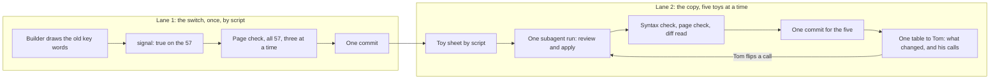

# Bar v3 rollout: every toy onto the new bar, with its copy

Status: in progress, 2026-11-17. Tom asked for it ("make a plan please so integration is easy") and ruled "Yes, run it" on its four decisions.
Tom, 2026-11-17, later the same day: "SIGNAL IS THE NEW DEFAULT AND WILL NOT BE A SWITCH -- afer we're done we're pulling out ALL legacy bars". The last stage below follows from it.
PR 72 (the shell and the first 30 toys) is on `main`: merge commit 8513a3fb, on Tom's "Yes, merge now".
Beans: `stimming-a5rs` (the epic), `stimming-hvtr` (the shell). Spec of the bar: `docs/plans/bar-v3.md`.

## The aim

Each toy with a bar spec runs Bar v3 and has its copy redone: labels, How to play, stage label, fail line.
The work for one toy must be small, the same each time, and safe to run five at a time.

## Where it stands

| | Toys |
|---|---|
| With a bar spec | 87 |
| On Bar v3 | 30 |
| On Bar v3 with the copy applied | 15 (the first ten, and batch 1) |
| On Bar v3 with a proposal that waits | 15 (batches 2, 3 and 4) |
| Not on Bar v3 | 57 |
| No bar spec; outside this plan | 26 |

## Why the first 30 were slow

1. Two subagent runs for each toy: one to read and propose, one to apply. About 280,000 tokens and two waits for Tom.
2. The shell did not yet answer what toys do with the old bar. Each gap showed up toy by toy.
3. The page check ran one toy at a time, about 70 s each, and the local server stalls under load.

## What makes a toy hard

A scan of the 57 toys left (`scan.py`, in the session's scratch folder) counts each pattern.

| # | Pattern | Of the 57 | Answer | State |
|---|---|---|---|---|
| 1 | The toy measures the old bar to keep its picture clear | 10 | `ui.cover()` and `ui.onCover()` in the shell; about 15 lines in the toy | Shell done; Pop field, Fidget board and Pin art use it |
| 2 | The toy writes a state to its old chip: on, hidden, off, a new label | part of 9 | Bar v3 mirrors the chip | Done |
| 3 | The toy guards its keys by `.s2-sheet`, or hands focus back from old chips | most | The shell holds keys under an open sheet and hands focus back | Done |
| 4 | A key word that Bar v3 cannot draw: `arrows`, `1-4`, `swipe`, `type`, `a + b` | 7 | Teach the builder these words once | To do: step 1 |
| 5 | Toy CSS that styles an icon through an old bar class | few | The same rule for `.sg-ui .sg-btn`, in the toy | By toy |
| 6 | A list the toy asked to show as a stepper | 6 | Bar v3 shows a button and a sheet of tiles | Tom rules: decision 2 |
| 7 | The toy's own palette on the old bar | 0 | `tray:` on the action (Prism has it) | Done |

38 of the 57 show none of patterns 1, 2, 4 and 5. Their switch is one line. The other 19: lava, sonar, shadyos, ink, windmap, dijkstra, fireworks, washer, lichtenberg, ascent, bench, canal, coil, flametest, honey, nvg, tornado, turing, ulam.

## The method: two lanes

### Lane 1: the switch

No subagent. One sitting.

1. **Shell.** The builder draws the old key words of pattern 4. A toy with no `help` list then shows a true How to play.
2. **Script.** `signal: true` goes into the `initPage` call of each of the 57.
3. **Page check.** Three toys at a time, each on its own port, with a time limit. 1280 px, 375 x 812, 812 x 375. About 25 minutes for the 57.
4. **Commit.** One commit. The scan's table goes into the epic: it names the 19 toys with a flagged pattern.

After lane 1 every toy with a spec runs Bar v3. A toy with pattern 1 has a known fault until lane 2 reaches it: the bar can stand on its picture.

### Lane 2: the copy

One subagent run for each toy does the review and the apply. Five toys run at a time.

1. **Toy sheet.** A script writes one page for the toy: its spec, each pointer, wheel and key handler with its line, the stage label, the fail line, and the scan's flags. The subagent reads the sheet first and the code only where it must.
2. **One run.** The subagent applies each row that follows the word rules. A row that is a matter of taste stays as it is, and the run lists it as "Tom's call". The run also moves a pattern 1 measure to `ui.cover()` and mends patterns 2 and 5.
3. **Checks.** The run does the syntax check. The main session does the page check and reads the diff.
4. **Commit.** One commit for the five, with one bean for each toy.
5. **To Tom.** One table for the five: what changed, and his calls. He answers only where he wants a call flipped.

Order:

1. The 15 toys whose proposals wait: batches 2, 3 and 4. Their reviews exist; each needs only the apply run.
2. The 38 toys with no flagged pattern, in the order of `toys.json`.
3. The 19 toys with a flagged pattern.

### The last stage: Signal by default, then the pull-out

1. **The default.** A toy with a bar spec gets Bar v3 with no flag. The shell's default flips, and a script takes `signal: true` out of every toy. This is the end of lane 1.
2. **The pull-out**, when lane 2 is done and Tom has looked. Bar v3 draws on the hidden parts of Bar v2 today and acts through its handles. So first Bar v3 takes over the handles, the key binding and the stored values; then the Bar v2 builder, its styles and its test page go, and with them the Classic pages' old bar. It is one piece of shell work, with its own bean and its own review.
3. Until the pull-out, `?bar=v2` stays as a test switch only. A toy's code need not serve the old bar.

## Time and cost

| | Before | With this plan |
|---|---|---|
| Subagent runs for one toy | 2 | 1 |
| Tokens for one toy | about 280,000 | about 150,000 |
| Waits for Tom for one toy | 2 | 0; he reads one table for five toys |
| Five toys, start to commit | about 60 minutes | about 20 minutes |
| The 72 toys left in lane 2 | about 14 hours, 20 million tokens | about 5 hours, 11 million tokens |

Lane 1 adds about one hour.

## Checks, and what each proves

| Check | Proves | Does not prove |
|---|---|---|
| Syntax check of each edited script | The page can start | That it behaves |
| Both type checks | The typed toys and the shell agree | |
| `tests/bar-v2.html`, 108 cases, after each shell edit | The old bar is intact | |
| Page check at three sizes | The bar draws, no control leaves the stage, the console is clean | That the picture is clear of the bar |
| Cover check with `?qa` | How many rows the bar takes at each size | That the toy uses the number |
| Play by hand; a touch screen; keyboard only | | Tom's, at sign-off |

## Done, for one toy

1. `signal: true`, and the page check passes at three sizes.
2. The copy follows the word rules; How to play lists each input that acts.
3. The toy keeps its picture clear of the bar under both bars, or its bean says why not.
4. Its bean holds what changed and Tom's calls; its doc in `docs/toys/`, if it has one, says what is true.
5. Tom signs off. Only then may Bar v2 leave that toy.

## Merging

Bar v3 is on for a toy only where its page says so, so `main` stays whole after each merge.

1. PR 72 holds the shell and the first 30 toys. It is ready to land when lane 1 is in and Tom has looked.
2. After that, one pull request for each 15 toys or so. A small request is easy to read and easy to back out.
3. `main` is merged into the branch at the start of each working day.

A merge to `main` publishes the site. Tom says when.

## Decisions for Tom

| # | Decision | Proposed |
|---|---|---|
| 1 | May a run apply the rows that follow the word rules with no wait? | Yes. Tom approved 25 of 25 proposals; his one change was "Keep Yours". |
| 2 | A list that a toy asked to show as a stepper | Keep Bar v3's button and sheet of tiles. |
| 3 | When PR 72 lands | Done: merged on 2026-11-17 on Tom's word, before lane 1 was in. The 57 toys of lane 1 follow in the next request. |
| 4 | The 26 toys with no bar spec | Outside this plan. Each needs a port to a bar spec first. |

## Risks

| Risk | Guard |
|---|---|
| Parallel page checks stall the local server | Three at a time; a time limit on each; a failed toy runs again alone |
| A subagent changes behaviour by accident | It may edit only its toy's folder; the main session reads each diff; the page check runs |
| The branch drifts from `main` | A merge of `main` each working day |
| The pull request grows too large to read | Slices of about 15 toys after PR 72 |
| The copy drifts between toys | One list of shared words in the subagents' brief; each new shared word goes into it |

## Open in the shell

- Three review findings: Googly eyes and Prism still measure the old bar; the sound hint after the intro pulses the hidden old button.
- The bar lab keeps its own copy of the builder, without the fixes since the port.
- `shared/signal.js` is not clean under Railgun's strict type check.
