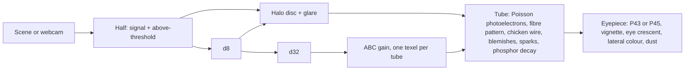

# Night vision (`nvg/`)

Lab toy. A shader showcase: an image intensifier tube over a moonless field.
Bean: `stimming-5bjs`. Branch: `feature/stimming-5bjs`.

## Files

| File | Holds |
|---|---|
| `nvg/index.html` | Shell, Bar v2 spec, layout, look, webcam, sound, loop |
| `nvg/scene.js` | three.js night scene in tube units (NIR albedo) |
| `nvg/tube.js` | The tube: six fullscreen passes |
| `shared/emblems/nvg.svg` | Intro emblem (placeholder) |

## Tube pipeline

- Signal unit: one photoelectron per cell per frame. A starlit field sits near 3.
- Shot noise is real Poisson below 10, Gaussian above.
- The halo disc is 5.5 % of the tube radius and fixed in tube space.
- ABC reads every d32 texel in each tube: mean plus peak energy. It drops fast, recovers slowly.
- The phosphor rises fast and decays with the Afterglow time.

## Controls

- Choice: Mono, Dual, Quad. A tall stage stacks the tubes in a column.
- Actions: IR (illuminator, drives eyeshine on the deer), Camera (webcam through the same tube).
- Slider: Gain. Settings: Phosphor, Afterglow, Grain, Quality.

## Open

- Dutch name, IPA, motto: Tom.
- Menu icon and emblem are placeholders; icon work happens in the toy's own chat.
