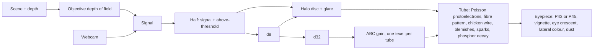

# Night vision (`nvg/`)

Lab toy. A shader showcase: an image intensifier tube over a moonless field.
Bean: `stimming-5bjs`. Branch: `feature/stimming-5bjs`.

## Files

| File | Holds |
|---|---|
| `nvg/index.html` | Shell, Bar v2 spec, layout, look, webcam, sound, loop |
| `nvg/atmos.js` | Shared air: two-layer height fog, sky with cloud, stars, emitters with fog glow |
| `nvg/harbour.js` | Harbour at 3 a.m. (default place) |
| `nvg/field.js` | Moonless field with ground fog |
| `nvg/apartment.js` | Room: a living room at 3 a.m. |
| `nvg/raid.js` | Raid: a blacked-out city under anti-aircraft fire |
| `nvg/tube.js` | The tube: depth of field, then six fullscreen passes |
| `shared/emblems/nvg.svg` | Intro emblem (placeholder) |

## Tube pipeline

- Signal unit: one photoelectron per cell per frame. A starlit field sits near 3.
- Shot noise is real Poisson below 10, Gaussian above.
- The halo disc is 5.5 % of the tube radius and fixed in tube space.
- ABC reads every d32 texel in each tube: mean plus peak energy. It drops fast, recovers slowly.
- The phosphor rises fast and decays with the Afterglow time.

## Places

- **Harbour** (default): quay, ten yachts with rocking masts, a fishing boat, breakwaters with green and red lights, channel buoys, a far town, a lighthouse sweeping through sea haze, a freighter at anchor, gulls, low cloud, a low moon with a glitter path.
  Water is a mirror pass of the whole world at half size; wave slopes stretch reflections into columns.
- **Field**: meadow, treeline, shed, road with a car, walker, deer, ground fog in the hollows.
- **Room**: street lamp through half-open blinds with real shadow-mapped stripes, dust lit only inside the shaft, a cat with eyeshine under IR, a pet camera's IR LED ring that lights the room for the tube, standby LEDs, a clock, a ceiling fan, a monstera whose leaves glow. Focus starts at 3 m.
- **Raid**: rooftop view over a blacked-out city. Eighteen light guns hose tracer bursts that burn out (some pop); heavy flak bursts high and leaves puffs; parachute flares drift down and light the city; searchlights sweep the smoke; ground blasts leave fires. Lights come from fixed pools, so shaders never recompile.
- Every built-in material gets the height fog through `fogify`. Lamps lose core light to fog and gain a soft glow.
- Easter eggs: an IR laser swept from the breakwater (10 s in 80), an IR strobe on the freighter's mast, the field's IR marker strobe.

## Blur layers

1. Objective depth of field: 26 mm f/1.2, blur radius from dioptre error. Focus at infinity blurs the near grass and water.
2. MCP halo disc, fixed in tube space.
3. Glare: a narrow skirt from d8, a wide one from d32.
4. Phosphor afterglow.
5. Eyepiece: an eight-tap ring blur that grows toward the rim.

## Controls

- Choice: Mono, Dual, Quad. A tall stage stacks the tubes in a column.
- Actions: IR (illuminator, drives eyeshine on the deer), Camera (webcam through the same tube).
- Slider: Gain. Settings: Place (Harbour, Field, Room, Raid), Focus, Phosphor, Afterglow, Grain, Quality.
- Double-click focuses on the point under the pointer.

## Open

- Dutch name, IPA, motto: Tom.
- Menu icon and emblem are placeholders; icon work happens in the toy's own chat.
