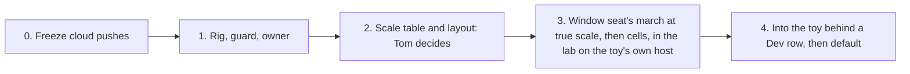
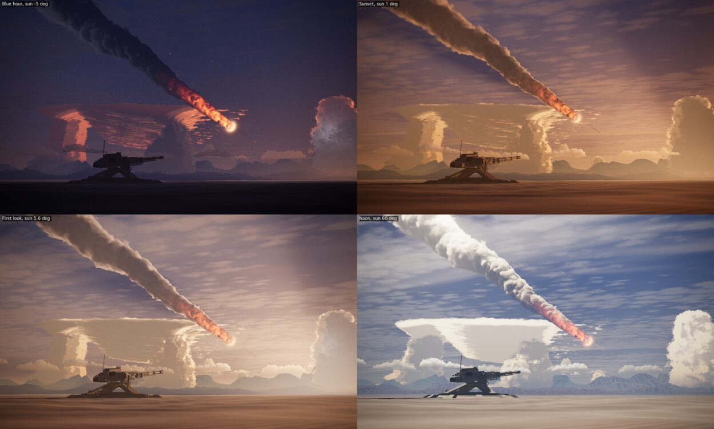
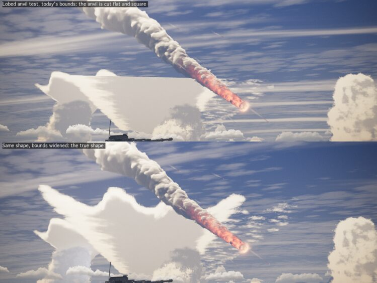
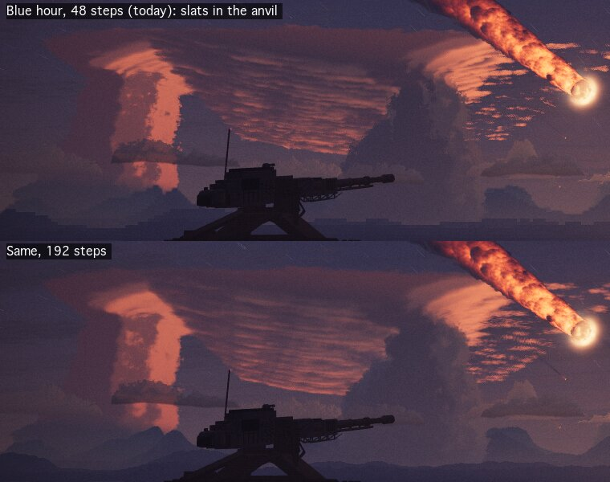
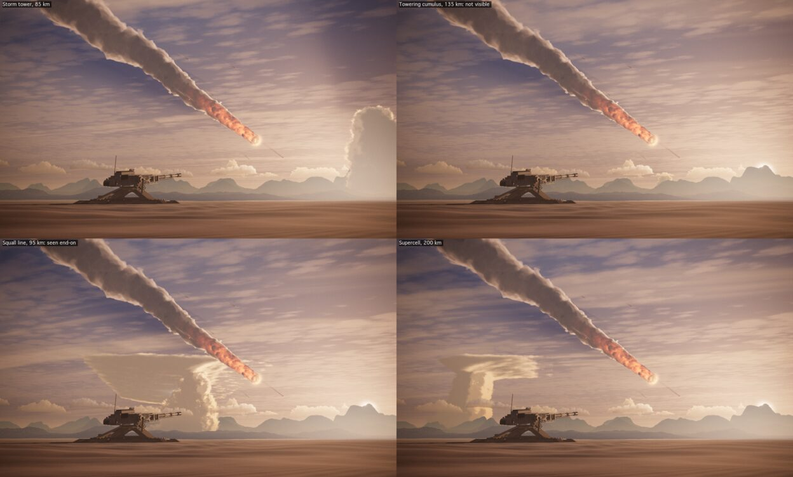
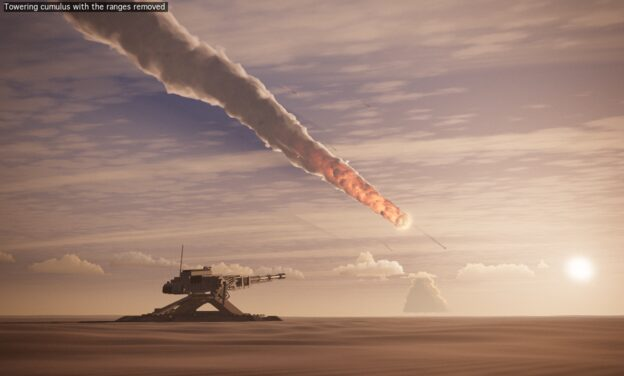
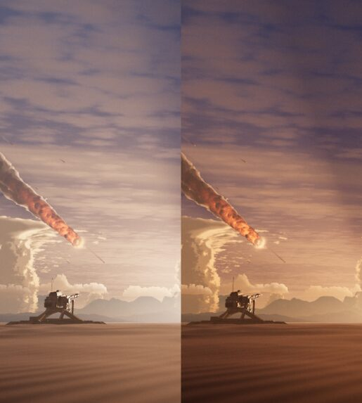
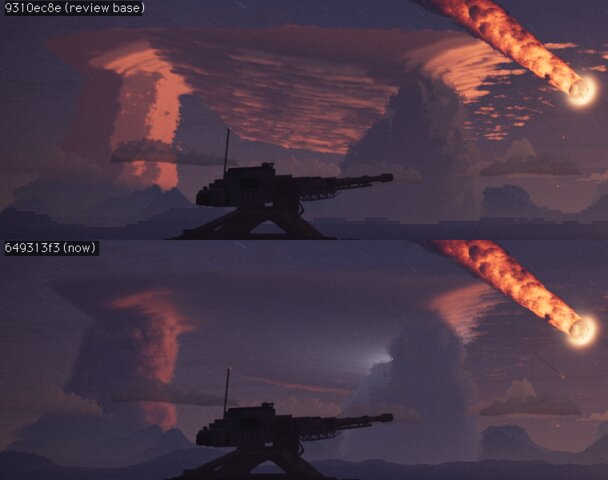
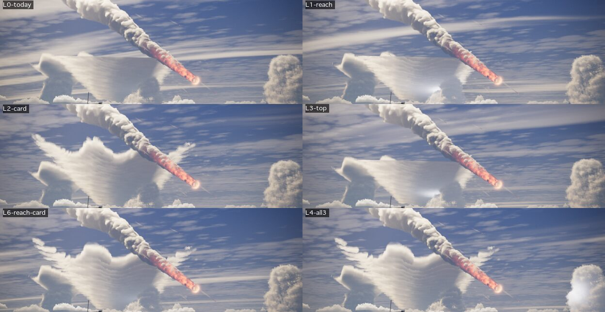

# Railgun clouds and storms: an outside review

> Bean `stimming-5yhc` (spike, under `stimming-626s`). 2026-11-16. Read-only: no code changed.
> Stills: `docs/qa/railgun-clouds-review/`. Method at the end.

## The answer in one paragraph

The clouds regress because the toy has no fixed target to hold them to and no check to catch a slip. Every note from Tom becomes a live push within minutes, from one of up to five sessions that edit the same 12,000-line file. The storm technique makes this worse: each storm's look depends on seven numbers in four places that must agree by hand, so a new shape is cut flat or square without an error. The layers also have no shared scale: the storms were scaled to ranges that had been replaced three minutes earlier. The fix is a process fix first (one owner, a still rig, a commit guard, a scale table), then a technique change (Window seat's tower march at true scale, then one storm field, lit from one sun model). The plan in section 8 asks Tom for three decisions.

## 1. Ranked root causes

| Rank | Cause | Kind | Evidence |
|---|---|---|---|
| 1 | Live pushes are the review loop, with no written target and no before/after gate; Tom's notes reach the owner second-hand | Process | Tom's 13:45 placement note was relayed as a lighting fix only (132992f8); the storms were not re-placed. His 15:24 shape note was never passed on (the ambient session's own account). 92 commits touched `railgun/index.html` from 12:00 to 16:00; 42 in the 13:00 hour. Same ask, two pushes a minute apart (a02130a6, 6767dd1c). A Tom fix undone seven minutes later (700162b0, 0a825d48). |
| 2 | Hidden coupling in the storm code: bounds kept by hand in four places | Technique | A lobed anvil is cut flat and square by today's bounds (still 02). The card is the cut (section 9): its size uses the table's width `W`, which the shape no longer uses. |
| 3 | Many writers in one file; whole-file commits of stale copies | Ownership | 16 beans committed to `railgun/index.html` today. Three overwrites: bb4e4154, e9fc9c83, and the restore 3dd36acf, which dropped a64abcf2. |
| 4 | No shared scale or layout table | Scale | 4a6113bb scaled storms to "ranges whose far crests reach 30 to 50 km", three minutes after e9fc9c83 cut the crests to 2.6 to 25 km. One storm is now hidden behind a range (stills 04, 05). |
| 5 | A lab that is not the toy, and no repeatable stills | Verification | The lab has its own copy of the air, no card, no ranges, no grade. Its Width slider does nothing in the lab and sets the toy's card width. A repeatable still needed four patches. |

## 2. What regressed today, and why

| Time | Commits | What happened | Cause |
|---|---|---|---|
| 12:59 to 13:00 | fa0f407e, reverted by 4b3ce769 | Giants as storm cells on cards: pushed, then reverted ("looked awful"). | A look went live before anyone saw a still. |
| 13:09 to 13:11 | bb4e4154, 3dd36acf, 78ad437e | The ranges session overwrote the range light sliders. The restore dropped the Storm flash button. A second restore put it back. | Whole-file commit of a stale `index.html`; restore by hand. |
| 13:20 to 13:36 | 94382571, 0963c308, b0b4891b, e19c5e3e, ecca3c41 | The storm probe went from a Dev trial to the default in 16 minutes, with four look changes between. | No look gate. |
| 13:28, then 15:23 | e19c5e3e, then 4a6113bb | Bases 5.5 to 6.5 km (giant 12 km) "clear of the horizon"; then bases 2 to 4 km with rain shafts. | Tom's asks changed ("too low", then "sense of scale"). Nobody held a reference to settle them. |
| 12:10 to 15:27 | 7b032fa6, 8c281d60, a02130a6, 9310ec8e | The clouds' haze: own haze, then one shared air, then a second fade put back for the cards only ("Far haze", now "Cloud far fade"). | A card and a storm at one distance now take different air: `CLOUD_FS` fades twice (line 2208), `STORM_FS` once (line 2402). |
| 13:45, then 15:24 | 132992f8; none | Tom: "put those clouds on the proper realistic positioning so they interact with light properly ... assess the world space". The relay passed on placement and light as one key-light fix; no storm moved. Tom: "more diverse and realistic shapes": not relayed to the sky session at all. | Notes go through a relaying session that paraphrases; nothing records what reached the owner. |
| 13:43 to 13:44 | a02130a6, 6767dd1c | "Colour crushed", then "crushed and way too harsh": two pushes in one minute. | Each note answered by a push, not a still. |
| 15:11, then 15:18 | 700162b0, then 0a825d48 | Tom: cloud light reads "blue like". 700162b0 made storm flashes plain white. 0a825d48, from the same bean, put the blue-white `FLASH_C` back and adds it after the air, so it is never warmed. | No record of Tom's ask that the next commit had to respect. |
| 15:20 to 15:21 | e9fc9c83, 5e41299f | The ranges session committed a stale `index.html` and wiped the rock fire globe, the far guns and the storm lab host. Restored one minute later. | `tools/commit.sh` in path mode takes the whole file with no staleness check. |
| 15:23 | 4a6113bb | Storms scaled to ranges that no longer existed (comment, `storms.js` line 9). | No scale table; cross-layer facts live in comments. |
| now | 4a6113bb with e9fc9c83 | The towering cumulus (135 km) stands behind the high range (near side about 132 km, crest 16.8 km): not visible at any sun (stills 04, 05). The new bases, shelves and rain shafts sit below the foothill line (about 2.9 degrees at 52 km) and do not show from the gun. | Storms placed without a check of what the camera sees. |
| now | storms.js | The squall line runs along `across` = (0.6, 0.8). The eye looks at it along (-0.47, -0.88): 98% aligned. Its row of cells and its shelf stack into one column (still 04). Every anvil runs broadside, because all storms share one wind. | One global wind; no per-storm framing. |
| reverted | ambient session, not pushed | Lobed anvils, mammatus, multicell and flanking-line forms. The lobes grew past `stormReach()` and the bounds cut them into square pillars. | Rank 2: reproduced in still 02. |

## 3. Structural causes

### Process

- A note from Tom goes to a session, the session pushes in minutes, Tom sees the live site, Tom sends the next note. The site is the review tool.
- Many of Tom's cloud notes reach the sky owner through the camera or ambient session, as a paraphrase. A paraphrase can narrow an ask (placement became a key-light fix) or drop it (the shape ask). Tom then sees no result and repeats the ask, angrier.
- No note becomes a written target. Conflicting notes (low bases or high bases; warm light or blue flashes) are settled by the last push, not by a reference.
- The plan already has a gate for the smoke train ("A change there needs a before/after still for Tom first", `docs/plans/railgun.md` line 199). The clouds have no gate.

### Ownership

- Five sessions edited cloud code or committed over it today: sky (`stimming-626s`), rock fire (`stimming-z267`, `uFill` in `STORM_FS` and `CLOUD_FS`), far guns (`stimming-ut05`, `uBolt` and `FAR_WARM` in cloud light), ranges (`stimming-l7oo`, `stimming-75xm`, whole-file overwrites) and ambient (the lobes).
- `tools/commit.sh -- <paths>` runs `git add --all` on the caller's whole file onto the branch tip. A session whose copy is behind erases every change it never pulled. `--hunks` is safe; path mode on a shared file is not, and nothing stops it.
- At the time of writing, the sky session said it would edit `shape()` and `setStorm()` again.

### Technique: seven numbers, four places, no error

A storm draws only if all of these agree, and nothing checks that they do:

| Bound | Where | Set from |
|---|---|---|
| The shape's true extent | `shape()`, `billow()`, `dens()` in `storms.js` | storm units, `H / 14` |
| The cylinder | `stormReach()`, `+ 2.0` margin | storm units |
| The top cut | `marchStorm()`: `p.y > sTop + 3.0` | storm units |
| The card quad | `STORM_VS`: `vec2(3.0, 1.5) - vec2(0.0, 0.2)` in `index.html` | the table's width `W`, in metres: not the shape's units |
| The empty-space skip | `gap` in `dens()` | assumes a distance field; `shape()` is not one (`y * 2.0`, `dy * 1.25`, `* 1.35`) |
| The step budget | `(t1 - t0) / 48.0`, 64 at most | the cylinder's chord: about 1.7 km per step at 85 km |
| Lightning spots | `stormSpot()` in JS: `3.4 * H / 14`, `12.2 / 14` | copies of `setStorm()` constants |

Today's defaults fit inside the bounds: with all bounds widened, the default storms do not change (checked at three suns). The trap opens on the next shape change: still 02 shows a lobed anvil cut flat on top and square at the side, and the same shape whole when the bounds are wider.

### Scale

| Layer | Distance | Height |
|---|---|---|
| Rock, whole fall | 47 to 42 km | 15.2 to 4.4 km |
| Heaps | 8 to 38 km | bases 0.85 to 3.25 km |
| Mids, deck, cirrus | 26 to 85 km | 4 to 6.5 km, 5.2 km, 9 km |
| Foothills | near side about 52 km | crests 2.6 to 3.1 km |
| Main, high, far ranges | about 84, 132, 170 km | crests 9 to 10.6, 15.6 to 16.8, 21.6 to 25.2 km |
| Storms | 85 to 200 km | tops 22 to 62 km; anvils 28 km and up |

- Earth's tallest peak is 8.8 km; storm tops reach 12 to 18 km. Each layer here was scaled on its own to answer "sense of scale".
- Two planet curves: `CURVE` drops `d² / 1.2e7` (radius 6000 km) for clouds and ranges; `hzFade()` and `dropAt()` drop `d² / 3.2e6`, 3.75 times deeper, for the rock and its smoke.

### Verification

- No fixed views, no fixed suns, no reference photos.
- No repeatable still. To get one I had to: pin the slow-frame ladder (a heavier march drops the resolution mid-capture), set the cloud clock, stop the random lightning, stop the ambient director. The cirrus and the deck still differ between loads.
- The lab is a copy, not the toy: its own air (3000 m dust, the old Far haze; it does not read `uAirK` from 9310ec8e), its own palette, no card, no ranges, no bloom or grade, no rock fire, a different night key light. Its Width slider does nothing in the lab and sets the toy's card width (`3 W`).

## 4. Stress test: can the card march give diverse cumulonimbus?

| Form | Today | What blocks it |
|---|---|---|
| One mature storm | Yes | Bounds by hand (above). |
| Multicell cluster | Partly | Five turrets at most on one foot. Separate storms do not share a march: overlapping cards blend in a fixed order, with no shared shadow or occlusion. |
| Flanking line | No | Needs a stepped row of towers on one flank. `sLine` is the only row and it runs across one global wind. |
| Sheared, fibrous anvil | Weak | The anvil is a flat wedge with stretched billows. `1 - exp(-5 d dt / U)` and `smoothstep(0, 0.6, v)` make it an opaque plate. 48 steps through a 0.5 to 6 km thick anvil give slats (still 03). |
| Mammatus | No | Thin pouches under the anvil break the skip bound and need finer steps. |
| Shelf cloud, rain shafts | In code, not on screen | End-on, and below the foothill line. |

Light, measured:

- An 8-tap integrated light march in place of the two taps changed 0.04% of pixels at the first look and 1.1% at noon. The flat look does not come from the taps.
- It comes from the fill terms (`0.32 sunC` plus a sky term of 0.4 to 0.85) and from 85 to 200 km of air (blue transmittance about 0.2 at 95 km).
- The sun's colour at a storm is the camera's palette (`uSunC`, `uCloudSun`) plus a narrow `litTop` band for the earth's shadow. It does not follow the sun's real path through the air to that point, so dusk light on a storm 200 km off is a guess.
- At blue hour the 48-step march cuts the lit anvil into slats (still 03).
- Tom's 13:45 note ("the far right cloud has the top of the column lit whereas the one on the left doesn't") can be right in nature: a storm toward the sun sees it higher, so its top stays lit longer. The toy cannot show it convincingly, because each storm's sun colour is the camera's palette plus a narrow band, not the sun's path to that storm.
- Backlight: at the first look the sun sits at x 0.86 on screen, beside the nearest storm (bearing -14). That storm shows its shadow side as a flat grey sheet with a bright rim (still 04, top left).

**Verdict.** The card march can draw one good cumulonimbus. It cannot be the base for diverse forms: every form is new primitive code with its own bounds, and storms cannot shade or hide each other.

### What should replace it, within three.js 0.170, 30 fps on Standard, no new library

0. **Start from Window seat's tower march, at true scale.** Tom already likes Window seat's clouds, so they are the reference that exists today. Its march steps in kilometres (0.3 km on High, 0.5 on Standard, longer with distance), sizes its cylinder from the anvil, the foot and the billow size and moves it downwind, picks billow detail by distance (`lodAt`), frays the ice anvil and thins a dying column (`gDecay`). Port that march as it is, with storms 12 to 18 km tall, and take scale from placement (section 5). The steps below build on it.
1. **One storm field, not storm objects.** A small top-down cell map built in JS from the storm table: each cell holds its place, radius, top, age and type. A height profile per type (cumulus, cumulonimbus with anvil, dying anvil) gives the vertical shape. The existing Perlin-Worley volume erodes it; shear with height bends it. A multicell, a flanking line or a squall line is a list of cells, not new GLSL. Mammatus is a bump field on the anvil base; a fibrous edge is stretched detail noise at low density. The bounds come from the same cell list, in one JS function. This is the approach of Schneider's Nubis clouds (SIGGRAPH 2015, 2017), cut down to far storms.
2. **Bake, then light, if the cost needs it.** The camera is locked off; storms 85 to 200 km out do not move on screen. Bake the storm band into a buffer a little wider than the view, as the ranges already do (5e212ac4): 192 steps or more, an 8 to 16 tap light march, one joint march through all cells so storms shade and hide each other. Store colour, cover, first-hit depth and thickness. Rebake over several frames when the sun or time moves. Each frame then reads one texture, adds the shared air, the lightning (through the thickness) and the rock's fire. The slow boil: rebake in the background and cross-fade.
3. **One sun model.** Sunlight per sample from the local sun height and altitude (a small transmittance table built in JS), in place of `uSunC` plus `litTop`. Storms, ranges, heaps and the deck then agree at dusk.
4. **Place storms for the camera.** Each storm keeps its top above the range behind it, stands at least 30 degrees off the sun's path on the Time slider (or is meant to be backlit), and has its own wind, so anvils and lines meet the eye at different angles. Check the landscape and the phone frame: on a phone today only half of one storm shows (still 06).

If the bake is too much for now: keep the live march, derive the card and the cylinder from one JS function of the storm's own numbers, add steps only in the anvil band, and add the bounds probe from section 6.

## 5. Tom's note: the rock and the layers do not feel cosmic

Measured along the fall (Mountain size, radius 1 km):

| Fall | Ground distance | Height | Elevation | Size on screen |
|---|---|---|---|---|
| 0.10 | 46.5 km | 15.2 km | 17.9° | 2.34° |
| 0.45 | 44.4 km | 11.0 km | 13.7° | 2.51° |
| 0.90 | 42.2 km | 5.6 km | 7.3° | 2.69° |
| 1.00 | 41.8 km | 4.4 km | 5.8° | 2.73° |

Why it does not read as cosmic:

1. **It falls inside the weather.** Its whole visible fall is between 15 and 4 km up: the height of the cirrus, the deck and the heaps. The storm tops stand at 22 to 62 km, behind and above it. On screen the supercell is about 17° tall; the rock is 2.5°.
2. **It hardly comes closer.** Over minutes it closes 4.7 km and grows 17%. Something arriving from space should grow many times.
3. **Nothing moves the eye.** The camera is locked off, so depth comes only from size, haze and overlap, and the size cue points the wrong way (point 1).
4. **The world was inflated around it.** Ranges reach 25 km and storms 62 km to give scale; that takes scale from the rock.

Two consistent options, Tom's choice:

| Option | Weather and land | Rock |
|---|---|---|
| A, Earth-true (recommended) | Storm tops 12 to 18 km, crests 3 to 9 km | First seen high and far (about 80 to 120 km up, 150 km or more out), above the anvils; it falls through the weather layers late, and grows on screen as it comes. |
| B, the inflated world | As now | Rock and path scaled about three times: larger, higher, farther. |

Either way, one scale table holds every layer, and no layer changes scale on its own.

## 6. Verification rig

**Still mode.** One hook in the toy, `__qa.still()` or `?qa=still`: freeze; set the sim clock and the cloud clock; lightning and ambient events off; the slow-frame ladder pinned; the rock at fall 0.45.

**Matrix.**

| Views | Suns (Time slider) |
|---|---|
| Wide 1280 × 800 (default eye) | 0.2 blue hour (-5°) |
| Phone 375 × 812 | 0.36 sunset (1°) |
| Tele on each storm: default eye, 10° lens (`__qa.eye`) | 0.5 first look (5.6°) |
| Sight | 0.72 (18°), 1.0 noon (60°), 0.05 night |

**References.** Tom picks one photo per row, kept with source and licence in `docs/qa/railgun-clouds/ref/` (Wikimedia Commons has CC photos of each): a distant storm over a plain at golden hour, a mature storm with a sheared anvil at midday, a multicell cluster, a supercell with a flanking line, a shelf cloud, mammatus at sunset, rain shafts from a far storm over desert, a storm backlit near the sun. The rig prints each render beside its reference.

**Golden set.** Tom-approved stills in `docs/qa/railgun-clouds/golden/`. Today's look is the first "before".

**Checks** (`tools/clouds-check.mjs`, about two minutes):

1. Bounds probe: render with the card, the cylinder and the top cut widened. Storm crops must match (under 0.2% of pixels off by more than 6%). It catches the lobes failure.
2. Steps probe: 48 against 192 steps in the storm crops. It catches slats.
3. Visibility: each storm shows a set area above the ranges in the wide view. It catches the hidden towering cumulus.
4. Colour: per storm crop, OKLCH hue and chroma of the lit side, and lightness spread (5th to 95th percentile). It catches a blue drift and crushed contrast.
5. Golden diff per crop, with a threshold.
6. Frame time on Standard.

**Gate.** `tools/commit.sh` runs the check when a commit touches `railgun/storms.js` or the sky code. A failure stops the push unless the message carries `look-approved:` with Tom's words.

## 7. Ownership rule

1. One owner session for the sky stack, bean `stimming-626s`: `storms.js`, the cloud cards, the storm host, the air, the sky, the sun palette and the scale table. Others ask the owner; the owner adds host hooks (as `stormExtra` does for the rock's fire).
2. Move the sky stack out of `index.html` into files (`railgun/sky/*.js`, with `storms.js`), so ownership follows paths.
3. `tools/commit.sh` refuses a whole-file commit when the caller's copy of that file is behind the branch tip, and points to `--hunks`. That alone stops the three overwrites of today.
4. A look change goes live only after Tom approves a before/after pair from the rig, as the smoke train's rule already says.
5. Each Tom note becomes one row in the plan before any code: the ask in his words, the reference photo, the view and sun that judge it.
6. A session that relays a cloud note to the owner sends Tom's exact words with the time, never a paraphrase, and the owner answers Tom with a still. The row in rule 5 records that it arrived.

## 8. Recommended plan

| Step | Who | Done when |
|---|---|---|
| 0. Freeze | All sessions | No cloud, storm, air or sky push until step 1 lands. |
| 1. Rig, guard, owner | Sky owner, one tools session | Still mode, matrix, golden "before", the six checks, the `commit.sh` guard. The lobes test fails the bounds probe; today's towering cumulus fails visibility. |
| 2. Scale and layout | Tom decides, owner builds | One scale table; storms placed by section 4 point 4; the rock's path per Tom's option. Tom approves wide and phone stills at three suns. |
| 3. Window seat's march, then cells | Owner, in the lab | Window seat's tower march at true scale first; then the cell list for multicells and flanking lines; a bake only if Standard cannot hold 30 fps. The lab imports the toy's host code, not copies. Lab stills beside the references; Tom approves. |
| 4. Into the toy | Owner | Behind a Dev row first, then the default after Tom's approval. |

Decisions for Tom:

1. Freeze cloud pushes until the rig lands: yes or no.
2. Scale: option A (Earth-true weather, a higher and farther rock) or option B (the inflated world, a bigger rock).
3. The reference photos: Tom picks them, or the owner proposes a set for him to cut.

## Method

- Headless Playwright 1.63 with `--enable-gpu --ignore-gpu-blocklist --use-angle=metal --enable-unsafe-webgpu`, at 1280 × 800 and 375 × 812, on `railgun/?sleep=999999&dev`. Each still: `__qa.freeze(true)`, `__qa.sun(v)`, `__qa.run(0.2)`, canvas `toDataURL` in the same evaluate.
- Repeatable stills needed four patches in the served page only (never in the repo): the slow-frame ladder pinned, the sim clock set to 15 s, lightning rate 0, ambient off; the rock at `__qa.fall(0.45)`.
- Experiments, also as served patches: 192 steps in place of 48; the card, the cylinder and the top cut widened; an 8-tap light march; the Anvil reach knob at 1.6; a lobed anvil; each storm alone; the ranges removed (`__qa.ranges([])`).
- The rock's place: `__qa.ast()` at falls 0.1 to 1.0.

| Still | Shows |
|---|---|
|  | 01: the four suns. Slats in the lit anvil at blue hour; at noon the anvils read as flat plates. |
|  | 02: a lobed anvil under today's bounds (cut) and with wider bounds (whole). |
|  | 03: 48 steps (slats) against 192 at blue hour. |
|  | 04: each storm alone. The towering cumulus does not show; the squall line is end-on. |
|  | 05: the towering cumulus with the ranges removed: a small lump on the horizon. |
|  | 06: the phone frame shows half of one storm. |

## 9. Addendum, 15:56: the march changed during the review; which bound clips

**The code moved under the review.** 649313f3 (15:33, `stimming-626s`) landed while I captured: Window seat's tower light in the shared march, a shorter stride inside the cloud (`min(dt, 0.45 U)`, 96 steps at most) and a Storm softness knob. Stills 01 to 06 show 9310ec8e. At blue hour the slats are mostly gone on 649313f3 (still 07). This is root cause 1 in action: the target moved while it was being judged.

**Which bound cuts a wider anvil.** The sky session reports that a wider `stormReach()` did not save its lobed anvils, and asks whether steps or the skip are to blame. On 649313f3, with the same lobed anvil at noon (still 08):

| Bounds widened | Result |
|---|---|
| None (today) | Cut flat on top and square at the side |
| Cylinder only (`stormReach() + 12`) | Still cut |
| Top cut only (`sTop + 30`) | Still cut |
| Card only (`STORM_VS`: 7 W, 2.6 H, from 0.8 H below the base) | Whole, except the far left lobes |
| Card and cylinder | Whole |
| Card, cylinder, top cut, then 192 steps in place of 48 | No visible change (0.6% of pixels) |

The cap is the storm card in `index.html` (3 W wide, from 0.2 H below the base to 1.3 H above it), sized from the table's `W` and `H`, not from the shape. The cylinder clips the farthest lobes as well. Steps and the skip are not the cause.

**The ambient session's lead on Window seat, checked in code.**

| Claim | Verdict |
|---|---|
| Window seat steps in fixed kilometres that grow with distance | Confirmed: `uTowStep` 0.3 (High) or 0.5 (Standard), `uTowSteps` 64 or 40 (`window/index.html` 1729 to 1731); `st = uTowStep * clamp(t0 / 70, 0.75, 2.2)` (`window/shader.js` 2161). The railgun stepped about 1.7 km before 649313f3 and about 1 to 2 km inside cloud now. |
| Railgun billows are in storm units, so lumps scale with storm height | Confirmed: `billow()` divides by `sTile`, in units of `H / 14`. |
| Window seat marches deck, mids and towers in one pass with one light | Confirmed for the towers' loop; the railgun splits cirrus, deck, cards, heaps and storms into passes lit by different sessions. |
| Window seat's cylinder is offset downwind and sized from anvil, foot and billows | Confirmed: `window/shader.js` 2145 to 2149. `stormReach()` is centred on the core with a fixed `+ 2.0`. |
| Window seat picks detail by distance, frays the anvil, thins a dying column | Confirmed: `lodAt`, the `far` fray and `gDecay` (2172 to 2181). The railgun has none. |
| Window seat towers are 12 to 15 km tall | Not checked. |

I agree with its conclusion and moved it into the plan as step 0 of section 4: port Window seat's march as it is, at true kilometre scale, and take scale from placement.

**A correction for the sky session's constraints.** Its note says the storm rows stand "against ranges of 30 to 50 km". Since e9fc9c83 the crests are 2.6 to 25.2 km (`railgun/ranges.js`). `storms.js` line 9 carries the same stale claim.

| Still | Shows |
|---|---|
|  | 07: blue hour on 9310ec8e and on 649313f3. |
|  | 08: the lobed anvil with each bound widened in turn. |
