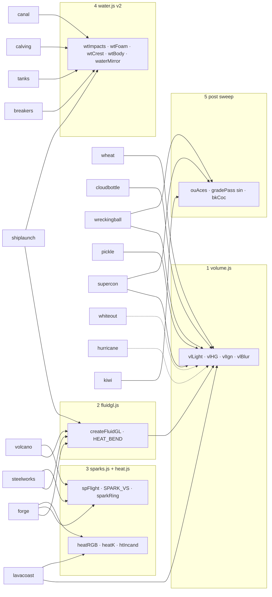

# Shared kit: the effects toys copy, and what to promote

Status: proposed · Bean: `stimming-psu8`

Tom, 2026-11-23: "open a new subsession that investigates shared modules, shaders and components (e.g. shaders, effects, droplets, glass window shader, fog etc etc -- We are on to something good here)".
Bean `stimming-psu8` (spike), under epic `stimming-3s8z`. A plan: no change in `shared/` or in a toy here.

This file extends three plans and does not repeat them:

- [shared-shaders.md](shared-shaders.md): the GLSL bundles of 2026-11-09 to 11-22 (flare, grade, output, sky, water, glow, precip, wet glass, the runner).
- [modularize.md](modularize.md): the JavaScript that repeats (audio, `gl.js`, `detail()`, colour).
- [fire-smoke.md](fire-smoke.md): `shared/fire.js` and its reach on 2026-11-16.

Since those audits, about 40 toys were built in parallel sessions (2026-11-17 to 11-23). Each copied the effect it needed from the nearest toy and retuned it.
This plan counts those copies per effect family, picks the best version of each, and ranks what to promote.

## How the survey was made

1. Real imports of every `shared/*.js`, counted by toy folder (workbenches and tests left out).
2. Four read-only sweeps over every toy folder: smoke and fire; water; glass, drops, translucency and fibres; sky, particles and post finishes.
3. Spot checks by hand: the `K3 lighting` files, a diff of two of them, the Forge and Steelworks diff, the ACES count.
4. The sibling session notes (QA notes and lessons), read as data.

Line numbers are from `HEAD` on 2026-11-23. `tanks/` is local and not committed; another session owns it.

## The finding in one paragraph

The authoring of shared bundles is ahead of their use. `wetglass.js`, `precip.js`, `bokeh.js` and `weather.js` each have one or two adopters.
The new copies sit in effects the kit does not hold yet: lit smoke and steam volumes, a WebGL2 fluid, sparks, hot-metal colour, foam, impact rings, depth of field.
Every copy is a fork of a neighbour, so a family drifts one toy at a time. Example: all nine `K3 lighting` copies use HG g = 0.55 and an extra 0.5 on the optical depth. Fire uses g = 0 and no 0.5. The first copy (Cloud in a bottle) retuned it, and the other eight copied the retune.

## What is shared today

| Module | Lines | Stack | Prefix or exports | Toys that import it |
|---|---|---|---|---|
| `detail.js` | 69 | JS | `detail()` | 62 |
| `gl.js` | 314 | Raw WebGL2 JS | `program`, `target`, `onContextLoss` | 46 |
| `glow.js` | 162 | GLSL + JS | `gw`, `bloomChain` | 45 |
| `grade.js` | 79 | GLSL + JS | `gd`, `gradePass` | 30 |
| `output.js` | 32 | GLSL | `ou` | 29 |
| `sky.js` | 156 | GLSL + JS | `sk`, `skyAt` | 8: breakers, calaeno, carwash, eastvan, spillway, tanks, tornado, wires |
| `water.js` | 145 | GLSL + JS | `wt`, `swellHeight` | 7: breakers, foghorn, lanterns, shiplaunch, tanks, tornado, trainride |
| `glassrain.js` | 115 | GLSL | `gr` | 5: carwash, hurricane, tornado, trainride, window (terrarium through the runner) |
| `flare.js` | 255 | GLSL + JS | `fl`, `flBuoy`, `flarePass` | 5: ascent, calaeno, launch, railgun, whiteout |
| `clouds.js` | 98 | GLSL + JS | `cl` | 4: gasgiant, hurricane, railgun, wires |
| `daytime.js` | 154 | JS | `HOURS`, `dayAt`, `dayClock` | 4: foghorn, jethover, rosewindow, wires |
| `environment.js` | 566 | Raw WebGL2 runner | `environment()` | 4: foghorn, lanterns, terrarium, tornado |
| `bokeh.js` | 34 | GLSL | `bk` | 2: carwash, trainride |
| `wetglass.js` | 75 | GLSL + JS | `wg`, `wetGlassMotion` | 2: carwash, tornado (terrarium through the runner) |
| `precip.js` | 76 | GLSL + JS | `pp` | 2: carwash, tornado |
| `precipfield.js` | 135 | GLSL + JS | `pf`, `PF_SNOW` | 1: whiteout |
| `rocket.js` | 328 | three.js 0.170 | `makeRocket`, `makeFlame` | 2: ascent, launch |
| `air.js` | 101 | JS | `AIR`, `sunLight` | 1: ascent |
| `weather.js` | 37 | JS | `weather()` | 1: foghorn |
| `smoke.js` | 71 | GLSL + JS | `sm`, `SM_FIRE`, `smConsts` | 1: whiteout (seven more carry a `K3 lighting` copy) |
| `fire.js` | 664 | three.js 0.186.1 WebGPU, TSL | `createFire`, `volume()` | 1: fire (Jet hover carries a full copy) |

## Inventory by effect family

"Raw" is raw WebGL2 GLSL. "0.170" is a three.js 0.170 `ShaderMaterial` or `RawShaderMaterial`. "TSL" is three.js 0.186.1 WebGPU.
Cost is the work to make one shared version and move the reference toy: S (a day), M (two to three days), L (a week or more).

| Family | Versions | Best today | Stacks | Drift | Cost |
|---|---|---|---|---|---|
| Smoke, steam, fog volumes: lighting | 9 marked `K3 lighting` copies, plus cauldron (2), volcano, gasgiant, steelworks, forge, fire.js, jethover | `cloudbottle/scene.js:180-196` (the template the standard names); Fire for the source maths | Raw, 0.170 | Body word for word in 5 (cloudbottle, wreckingball, pickle, supercon, wheat); only the shadow taps differ. Constants retuned in 3 (lavacoast, shiplaunch, cauldron). Structure changed in 2 (whiteout, hurricane). Steelworks and Forge light another way | S |
| Smoke, steam: WebGL2 fluid | 4: `steelworks/fume.js`, `forge/steam.js`, `volcano/plume.js`, `shiplaunch/mist.js`; about 190 solver lines each | `steelworks/fume.js` (fluid, MRT heat, heat bend) | 0.170 Raw | Forge is Steelworks with 66 lines of scale constants. Volcano and Ship launch add flame emission and a two-lobe phase | M |
| Smoke, steam: TSL fluid | `shared/fire.js`; `jethover/gas.js` (760 lines, a whole copy plus jets, floor, steam ring, sky light, heat twin); `cauldron/gpufire.js`; `spark` (from Ink) | Jet hover | TSL | Jet hover is Fire word for word plus marked additions | L (fire.js with hooks) |
| Smoke trains | railgun `src/rock/trail.ts`, `calaeno/trail.js`, `launch/index.html:1254-1483` | Railgun | 0.170 | Same maths; Calaeno renamed, Launch retuned the phase | M (named in fire-smoke.md) |
| Heat haze | Steelworks FUMEMIX, Forge STEAMMIX, Jet hover `fx.js:90-125`; 6 more written alone (railgun, cauldron, deepvent, gasgiant, rubens, chocolate) | Steelworks (gradient bend from the volume's heat) | 0.170, TSL | Forge is word for word (bend 30 to 14). Jet hover is a TSL port | S |
| Fire flames and hot colour | Fire ramp in fire.js, jethover, cauldron (2), volcano, gasgiant; hot metal in forge (`heatRGB`, degrees C), steelworks and lavacoast (`incand`), lavaskin (Planck), eventhorizon (Kelvin fit) | Forge for metal (absolute degrees C); Fire for flame | All | Same shape, different units and gain: Forge's iron cannot match Lava coast's lava by number | S |
| Water surface | 26 toys; 7 on `water.js` | Window seat for open sea; Ship launch for close water (Tom's Ponlai reference); Meteor and Tide for surf | Raw, 0.170 | Repeated, not shared: planar mirror (6), mirror smear (8 tap counts), impact rings (6), lace foam (8 ways), body absorption (8), backlit crest (4), Schlick inline (10) | L |
| Drops and wet glass | 8 pane toys; 6 on `glassrain.js`, 2 on `wetglass.js` | Car wash on the shared path (Tom set its defaults); Rain as the stand-alone sim (a named strength, must not change) | Raw, 0.170 | Train Ride is the source of `wgPane` but still inlines it. Window seat runs its own flow. Wipe masks: 5 ways (rain, window, terrarium, carwash, hurricane) | S |
| Glass and refraction | 15 toys; thin film in 3 models (LUT, Airy, sin squared) | Glass (named strength); Bismuth for the Airy film | Raw, 0.170 | The CIE 1931 fit near word for word in 7 (bubbles, bismuth, oilslick, dichroic, prism, doubleslit, flametest); `spectral()` in 3 (rupert, stone, cuttle) | S |
| Translucency, SSS | kiwi, honey, soap, pickle, putty, lava, jellyfish | Kiwi `BEAD` (`kiwi/glsl.js`, already an export); Honey for slabs | 0.170, Raw | Wrap diffuse inline in about 15 toys, constants differ; no word-for-word copies | S |
| Hair, fibres, fuzz | kiwi, purr, dandelion, wheat, tornado, desirepaths, hookloop, jellyfish, glowworm, terrarium | Kiwi fuzz (`kiwi/fuzz.js`, 185 lines); Purr for shell fur | 0.170, Raw | Kajiya-Kay near word for word in 3; the pixel-floor ribbon written 6 ways | M |
| Sparks and particles | Closed-form drag flight in 7 (fireworks, meteor, launch, railgun, steelworks, forge, spark); fireworks star shader in 4 | Forge (`forge/sparks.js`: ring upload, temperature, forks); Spark Wheel for chained bounces | 0.170, Raw, TSL | Forge is Steelworks with temperature. Same physics written 7 times | M |
| Sky and time of day | daytime.js in 4; own hour tables in window, trainride, walker, railgun, lanterns, jethover (palettes) | `daytime.js` with `sky.js` | All | `k2stars` in canal, launch, meteor equals `skStars`. A fixed-sun dome in wreckingball, drone, shiplaunch (near copies) | S |
| Post finishes | ACES `aces()` local in 39 files; the night `makeGrade` in 9; a sine-hash grain and vignette pass in 5 new toys (steelworks, forge, volcano, wreckingball, supercon) | `grade.js` and `output.js`; Kiwi `post.js` for depth of field; Railgun for letterbox, fringe and lens dirt | All | ACES copies are word for word. The 5 new grades match `gradePass({ noise: 'sin' })`, which exists | S per toy |

## Promote first: the ranked list

Rank weighs four things: copies today, the look (the best version is good enough to be the default), the cost, and how many new toys will want it next.
Tom asked for smoke, fog, drops and glass by name, so those rank first where the counts allow.

| # | Module | Copies it ends | Reference port | Then | Cost |
|---|---|---|---|---|---|
| 1 | `shared/volume.js`: K3 volume lighting in GLSL | 9 marked, plus 6 near | `wheat` (word for word, raw, small file) | cloudbottle, wreckingball, pickle, supercon; then lavacoast, shiplaunch, cauldron with their constants | S |
| 2 | `shared/fluidgl.js`: the WebGL2 K3 fluid and the heat bend | 4 fluids, 3 bends | `forge` (the newest, the smallest box) | steelworks, volcano, shiplaunch | M |
| 3 | `shared/sparks.js` and `shared/heat.js`: drag flight, streaks, hot colour | 7 flights, 6 ramps | `forge` (sparks and `heatRGB` in one toy) | steelworks, lavacoast, volcano; the fireworks family later | M |
| 4 | Water kit v2 in `shared/water.js`: rings, foam, crest light, body, mirror | 6 + 8 + 4 + 8 + 6 | `breakers` (rings and lace word for word with tanks) | tanks, shiplaunch (foam), calving, canal (mirror) | L |
| 5 | Post sweep: `ouAces`, `gradePass` for the new grades, depth of field in `bokeh.js` | 39 + 5 + 2 | `wreckingball` (sine grade); `kiwi` (depth of field) | supercon, steelworks, forge, volcano; the raw ACES toys | S each |
| 6 | Wet glass: `wgWipe`, and the two toys that still inline it | 5 wipes | `trainride` onto `WET_GLASS` (planned since 11-10) | window onto `wetGlassMotion`; hurricane, terrarium wipes | S |
| 7 | `shared/spectrum.js`: CIE weights, `spectral()`, thin film | 7 + 3 | `oilslick` | bismuth, bubbles, dichroic, prism | S |
| 8 | `shared/translucent.js`: Kiwi's bead, wrap, HG | new | `kiwi` (moves its own `BEAD`) | honey, soap, toonfruit | S |
| 9 | `shared/fibre.js`: ribbons with a pixel floor, Kajiya-Kay | 6 ribbons, 3 sheens | `kiwi` | dandelion, wheat, desirepaths, purr | M |
| 10 | Sky additions: `skDome`, `dayKeys`, `skStars` for `k2stars` | 3 + 5 + 3 | `wreckingball` (dome) | drone, shiplaunch; canal, launch, meteor stars | S |

Why this order:

1. Volume lighting is the smallest change with the most copies, and it is the effect Tom named. Five copies are word for word, so the port is a same-frame check, not a look change.
2. The WebGL2 fluid already exists four times. [fire-smoke.md](fire-smoke.md) kept Option A ("a WebGL2 twin, only on demand"). Four toys made that twin by hand since; the demand is here. Tom decides.
3. Sparks and hot metal are the next new-toy magnets: Steelworks and Forge both shipped on 2026-11-23 with copies, and the idea list has more foundries and forges.
4. Water has the most toys and the most drift, but each water is a look. It is the largest job, so it goes after the cheap wins.
5. The post sweep changes nothing on screen and stops the next new toy from copying a grade.



A dotted line is a structural fork: it moves only if Tom wants the common look.

## Proposed API per module

Every GLSL module follows the contract in [shared-shaders.md](shared-shaders.md): plain functions, no uniforms, a prefix, `texture()` only, imports nothing. The same text compiles in raw WebGL2 and in a three.js 0.170 `ShaderMaterial`.
A module that needs three.js classes takes them as arguments, as `fire.js` does.

### 1. `shared/volume.js` (prefix `vl`)

GLSL has no function pointers, so the toy keeps its own density function and its own shadow taps. The module takes the optical depth.

```glsl
float vlHG(float cosT, float g);                  // normalised, 1 / 4 pi
float vlPhase2(float cosT, float g1, float g2, float w);
vec3  vlLight(float tau, float dens, vec4 look);  // look: absorb, multi, powder, ambient
float vlIgn(vec2 px, float frame);                // interleaved gradient noise, turned per frame
```

```js
import { VOLUME, VOLUME_BLUR, VL_K3, VL_FIRE, volumeDetail } from '../shared/volume.js';
// VL_K3: the template's numbers (g 0.55, tau x 0.5, absorb 2, ambient 0.5, powder 0.59, multi 1).
// VL_FIRE: Fire's numbers (g 0, absorb 2, ambient 0.5, powder 0.59, multi 0.5).
// VOLUME_BLUR: the 3-tap separable blur pass, a fragment body.
// volumeDetail(level): march steps and buffer scale per detail level.
```

- A toy sums its taps and calls `vlLight(tau, d, look)`. The five word-for-word copies pass `VL_K3` and keep their taps.
- Fire's TSL lighting (`shared/fire.js:540-563`) stays the source. The GLSL text names it in a comment, and the lab checks one against the other on a fixed density field.
- Whiteout and Hurricane keep their own lighting unless Tom wants the common look.

### 2. `shared/fluidgl.js`

The four fluids run on three.js 0.170 with `RawShaderMaterial`. The grid packs its y slices as tiles in one 2D texture.

```js
const fluid = createFluidGL({ THREE, renderer, grid: [48, 64, 48], size, center,
                              pressure: 18, heat: true });
fluid.u.buoyancy.value = 1.2;          // every knob is a uniform, as in fire.js
fluid.setEmitters(list);               // spheres or jets: { pos, radius, dens, heat, vel }
fluid.step(dt);
fluid.march;                           // GLSL: the ray march, calls vlLight from volume.js
fluid.textures;                        // { dye, heat }: for the toy's own pass
fluid.dispose();
```

- `HEAT_BEND`: Steelworks' FUMEMIX, the screen bend along the heat gradient, capped in pixels. Options `bend` and `cap`.
- Jet hover's TSL bend (`jethover/fx.js:90-125`) becomes `heatBendNode(TSL, ...)` in `fire.js` later, beside the volume.
- The toy keeps its emitters, its colours and its sound.

### 3. `shared/sparks.js` and `shared/heat.js`

```glsl
vec3 spFlight(vec3 p0, vec3 v0, float drag, vec3 g, float t);  // closed-form linear drag
// SPARK_VS: the streak quad from tail to head, a shutter time, a 1 px floor with matching dim.
```

```js
const sparks = sparkRing({ THREE, cap: 4000, floorY: 0 });
sparks.emit({ pos, dir, cone, speed, n, temp });  // writes once into the ring
sparks.fork(p, v, n);                             // carbon forks
sparks.mesh;                                      // InstancedMesh, One/One blending
sparks.update(time);                              // addUpdateRange on the new slots only
```

```js
// heat.js: JS and GLSL twins, linear light.
heatRGB(celsius);   // Forge's 9-stop table, 450 to 1450 C, absolute gain
heatK(kelvin);      // Planck at three wavelengths, from Lava skin
htIncand(t);        // the 0..1 curve Steelworks and Lava coast use
```

- One/One `CustomBlending` is built in: Volcano's note records that `AdditiveBlending` draws nothing when the shader writes alpha 0.
- The fireworks star shader (4 copies) is a separate step, `shared/shells.js`, after this one.

### 4. Water kit v2 (additions to `shared/water.js`)

```glsl
vec3  wtImpacts(vec2 p, float t, vec4 rings[8], int n); // slope xy, steepness z
float wtFoam(vec2 p, float amount, float age, float px); // lace from a mat; hard fwidth edge
float wtCaps(float slope, float wind, float foot);       // whitecap share
vec3  wtCrest(vec3 n, vec3 v, vec3 sun, float h);        // light through thin crests
vec3  wtBody(float depth, vec3 sigma, vec3 scatter);     // per-channel absorption
vec3  wtSmear(sampler2D mirror, vec2 uv, float len);     // tap count from detail
```

```js
const mirror = waterMirror({ THREE, renderer, scene, camera, layer, clip: 'oblique' });
mirror.render();   // before the water pass; mirror.texture for wtSmear
```

- Foam comes from Ship launch's Ponlai port (`shiplaunch/foam.js`). It needs a `CREDITS.md` row (MIT).
- Breakers and tanks carry `ringGrad` and the lace block word for word: the first proof.
- Each water keeps its colours, its sky and its lights. Moving a toy onto the parts changes its look only where Tom says so.

### 5. Post sweep (additions to existing modules)

| Change | Module | Proof |
|---|---|---|
| The 39 local `aces()` become `ouAces` | `output.js` (exists) | Same text: 0 pixels differ, as Stone proved |
| The 5 sine-hash grades become `gradePass({ noise: 'sin' })` | `grade.js` (exists) | Same maths; 1/255 |
| `box` (letterbox) and `fringe` options | `grade.js` | Meteor, Launch, Railgun keep their frame |
| `bkCoc`: depth-aware gather, far-behind-sharp guard, foreground cover | `bokeh.js` | Kiwi keeps its frame; then Observatory |
| Lens dirt from Railgun's bloom | new `shared/dirt.js` | Railgun and Observatory, 2 copies |

### 6 to 10 in short

| # | Module | API |
|---|---|---|
| 6 | `wetglass.js` | `wgWipe(tWipe, uv)` reads a clear mask; JS `wipeMask(gl, size)` with `brush(x, y, r)` and a regrowth time |
| 7 | `shared/spectrum.js` | JS `cieWeights(lambdas)`; GLSL `spSpectral(l)`, `spFilmAiry(d, cosI, n)`, `spFilmLut(tLut, d, cosI)` |
| 8 | `shared/translucent.js` | Kiwi's `BEAD` as it is (`tlExit`, `tlBead`, `tlThrough`); `tlWrap(ndl, w)` |
| 9 | `shared/fibre.js` | `fbRibbon(T, V, width, pxAtDist)` gives the offset and the cover; `fbKajiya(T, H, p)`; `fbWrap(T, L)`; `fbBezier(p0..p3, t)` |
| 10 | `sky.js`, `daytime.js` | `skDome(dir, sun, zen, hor, band)`; `dayKeys(table, hour)` blends a toy's own palette table by the hour |

## How each switch proves the same frame

Decision 12 holds: a shift of 1/255 on a few pixels counts as the same frame. A larger change needs Tom's look.

| Kind of copy | Proof |
|---|---|
| Word for word (5 K3 copies, 39 ACES, Breakers rings) | `fxlab/` "Check a copy" on the function. Then a headless frame diff with a frozen clock and seeded `Math.random`: 0 pixels differ |
| Retuned constants (lavacoast, shiplaunch, cauldron) | The toy passes its own numbers. Frame diff within 1/255 |
| A WebGL2 fluid | Run the old page against itself first: a fragment-pass fluid has no write race, so it should be bit stable. If so, old against new must give 0 pixels. If not, use Fire's three-part proof (same shader text, frames inside the noise, a t-test on look metrics) |
| A TSL copy (Jet hover) | Fire's proof: the same WGSL text with digits masked, then frames inside the noise |
| A structural fork (whiteout, hurricane, steelworks lighting) | No proof possible: it is a look change. Tom looks at an A/B first |

Capture: Edge headless on D3D11, the renderer string checked; ANGLE GL for the heavy toys.
Each adoption commit names the copy it removed and its proof, as [modularize.md](modularize.md) asks.

## A rule to stop the next copy

Most copies are less than a week old. A module ends only the copies that exist; the next toy in a parallel session copies again unless a rule stops it.

Proposal for Tom (a standard changes only from his words):

1. A new toy imports a kit effect when one exists. It does not copy a toy.
2. When the kit effect lacks a knob, the toy's chat opens a bean for the knob. Until Tom says yes, the toy may keep a marked local copy (`// copy of shared/<module>, <reason>`).
3. Each module's header names its best example toy, so a new toy starts from the module and the example together.

## A workbench to choose by eye

The defaults need Tom's eye in two places: the volume look and the water parts.
Proposal: `fxlab/spike-volumes.html` (`noindex`). One density field and one key light, lit nine ways: the nine `K3 lighting` copies, Fire's numbers and the template's numbers side by side. Tom picks the default `look`.
Later, the same for foam and impact rings on one water patch.
Not built: it waits for Tom's yes.

## Doc fix found on the way

`docs/standards/code.md` (Shared code) says: start a raw WebGL2 volume "from `jethover/fluid.js` or `cloudbottle/scene.js`". `jethover/fluid.js` no longer exists: Jet hover moved to `jethover/gas.js` (TSL) on its WebGPU move, and Steelworks keeps the WebGL2 port (`steelworks/fume.js`).
The standard changes only from Tom's words, so this plan does not edit it.

## Open questions for Tom

1. The default volume look: Fire's numbers (HG g 0, no extra 0.5 on the depth) or the template's (g 0.55, depth times 0.5) that all nine copies use? The module keeps both; the question is the default.
2. The WebGL2 fluid: fire-smoke.md kept it "only on demand". Four toys built it by hand. Promote it to `shared/fluidgl.js`?
3. Order: start with the volume lighting (the effect you named) or the post sweep (no visible change, 40 toys)?
4. The rule above (kit first, a bean for a missing knob): add it to the code standard?
5. The volume workbench (`fxlab/spike-volumes.html`): build it before the module? And `code.md` points at `jethover/fluid.js`, which is gone: change it to `steelworks/fume.js`?
