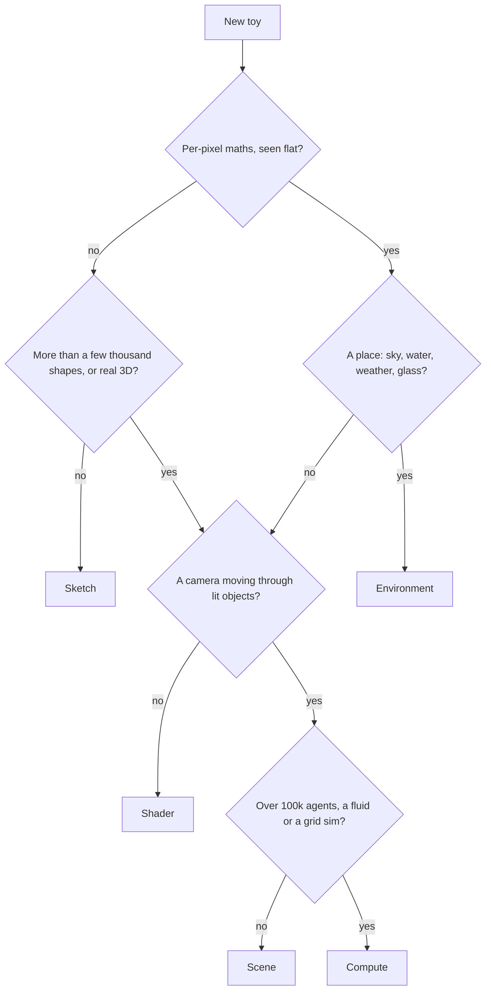

# Stack types and renderer inventory

Bean: `stimming-xcs8` (epic `stimming-3s8z`). Audit of 2026-11-14. A proposal: Tom picks the types. Nothing is ported.

Tom, 2026-11-14 (spoken): "We also want to have a list and an inventory of which toys run on three.js or GLSL or WebGPU ... and we also need to come up with several default stack types. Simple toys may not necessarily need three.js, whereas more involved ones do."

`docs/stack.md` keeps the tiers, the library set and the reasons. This file holds the full inventory, the mismatches and the stack types. `docs/plans/modularize.md` holds the shared code each type uses.

## Count per renderer

Counted from real imports and `getContext` calls in each toy's live page and its local modules, not from the importmap.

| Renderer | Main shelf | Lab | All |
|---|---|---|---|
| DOM / SVG | 1 | 0 | 1 |
| Canvas 2D | 0 | 6 | 6 |
| Raw WebGL2 (GLSL) | 17 | 19 | 36 |
| three.js 0.170.0, WebGL | 20 | 22 | 42 |
| three.js 0.186.1, WebGPU (TSL) | 3 | 0 | 3 |
| Raw WebGPU (WGSL) | 0 | 0 | 0 |
| **Toys** | **41** | **47** | **88** |

Plus `postcard`: in `toys.json` with no folder. `ascent` is new in the Lab since the first audit.
Fog horn counts as raw WebGL2: `shared/environment.js` makes its context.
Of the 42 three.js toys, 3 draw only one orthographic view (`morpher`, `pop`, `ulam`) and 2 more need a check (`prism`, `bubbles`).

| Other facts | Count |
|---|---|
| Standard importmap, word for word | 49 |
| Partial importmap (three.js entries only) | 17 |
| WebGPU importmap (three 0.186.1) | 3 |
| No importmap (the page imports no library) | 19 |
| Bar v2 / v1 / own shell | 63 / 24 / 1 |

## Mismatches

| # | Mismatch | Toys | Weight | Recommendation |
|---|---|---|---|---|
| 1 | **three.js where raw WebGL2 does the job.** One orthographic camera, one or a few full-screen or sprite meshes, no lights, no 3D scene | `morpher`, `pop`, `ulam`. Check: `prism` (beams on a bare `THREE.Camera`), `bubbles` (orthographic, but `RoomEnvironment` reflections) | 170 KB gzipped and 50 to 150 ms start-up each, for nothing | Shader type. `pop` needs `bloomChain()` for its `UnrealBloomPass` and is signed off: last of the three |
| 2 | **Partial importmap.** Only `three` (and `three/addons/`), not the standard text | `morpher`, `domino`, `pins`, `ferro`, `magnet`, `soap`, `pendulum`, `walker`, `tvtree`, `balloons`, `bubbles`, `coil`, `dandelion`, `cube`, `snow`, `top`, `tesseract` | Works today. Breaks the word-for-word rule; a later `import 'gsap'` fails at load | Paste the standard map in each toy's next change. Zero risk: the map loads nothing by itself |
| 3 | **WebGPU with no WebGL2 path.** The three WebGPU toys check `renderer.backend.isWebGPUBackend` and show one line otherwise | `galaxy`, `fire`, `ink` | Browsers without WebGPU see a blank stage and one line, on three main shelf toys | Compute type rule: show a still frame and the line at least. Where the sim allows, run a smaller version on the WebGL2 backend. Tom decides per toy |
| 4 | **Two three.js versions.** 0.170.0 for WebGL, 0.186.1 for WebGPU, with a `three.core.js` alias | 42 and 3 | Two downloads in the cache; code cannot move between the two (TSL nodes against `ShaderMaterial` GLSL) | Keep both, on purpose: one pin per type. Move 0.170 only as one planned step, never per toy |
| 5 | **Raw GLSL that rebuilds three.js.** Own `perspective`, `lookAt` and pose matrices for a 3D object | `bismuth`, `chladni` (`lookAt` only) | Small today. It grows with each feature three.js gives for free (picking, shadows) | Stay Shader while the view is one object. Scene if it grows |
| 6 | **Canvas 2D doing per-pixel work on the CPU** | `harmono` (`putImageData` each frame); `kaleido` builds its source with `putImageData` | Frame cost grows with the screen | `harmono`: Tom called it "way too involved"; leave it. No other Canvas 2D toy needs the GPU |
| 7 | **No fail line.** A GPU toy with no message when its context fails | `pop`, `nvg`, `eastvan` | A blank stage on a machine without WebGL2 | One line in each toy's next change |
| 8 | **Unused libraries in the importmap** | Every page with the standard map | None: a library downloads only when imported. No page `modulepreload`s a library it does not use | No action. The word-for-word rule wins |
| 9 | **Shell** | 24 toys on v1, `eastvan` on its own | Not a renderer issue | Epic `stimming-80dc` (Bar v2 migration) owns it |

## The stack types

Five types. A new toy picks one in its bean, before the first line of code (`docs/stack.md`, rule 1). The type fixes the renderer, the importmap, the shared modules and the budget.

### 1. Sketch: DOM, SVG or Canvas 2D

| | |
|---|---|
| Pick it for | A few crisp objects, text, vector parts, up to a few thousand shapes; motion by tweens |
| Renderer | DOM and SVG, or one Canvas 2D |
| Importmap | The standard map if it imports GSAP or simplex-noise; none if it imports nothing |
| Starter files | `index.html` only |
| Shared modules | `stim.js`: `initPage`, `fitCanvas`, `whenVisible`, `reduced`, `css`, `oklchRgb`, `audioKit` |
| Budget | No GPU context. 60 fps. Canvas through `fitCanvas`. No per-pixel loops on the CPU. Idle stops the loop |
| Reference | `fidget` (Fidget board) |

### 2. Shader: raw WebGL2 and GLSL

| | |
|---|---|
| Pick it for | Full-screen fragment work, fields, ping-pong sims, particles on textures, anything per pixel and seen flat |
| Renderer | One WebGL2 context, a full-screen triangle |
| Importmap | Standard map (it loads nothing unless imported) |
| Starter files | `index.html`; GLSL as `/* glsl */` strings |
| Shared modules | `stim.js` (`fitCanvas`, `whenVisible`, `audioKit`), `output.js`, `glow.js` (`bloomChain`), `grade.js`, `detail.js`. Proposed: `gl.js`, `noise.js` |
| Budget | No library download. Standard: pixel ratio 2 at most, 1.4 M pixels. Six passes or fewer per frame. 30 fps floor through `detail()`. A fail line |
| Reference | `vortex` (Vortex): main shelf, Bar v2, kit sound, standard map. It still carries a local `aces()` and `rung` watch: the model, once it adopts `output.js` and `detail()` |

### 3. Environment: raw WebGL2 on `shared/environment.js`

| | |
|---|---|
| Pick it for | A place: sky by the hour, water, weather, wet glass, lights. The scene is one GLSL function |
| Renderer | Raw WebGL2, through the runner |
| Importmap | Standard map |
| Starter files | `index.html` with `vec3 envScene(vec2 uv)`, the bar and the sound; textures as `.webp` |
| Shared modules | `environment.js`, which wires `sky.js`, `water.js`, `precip.js`, `wetglass.js`, `flare.js`, `glow.js`, `grade.js`, `output.js`, `weather.js`, `detail.js` |
| Budget | The runner owns the loop, the pixel ratio and each bundle's budget (`detail()` levels). One key light. One full-screen scene pass |
| Reference | `foghorn` (Fog horn) |

### 4. Scene: three.js 0.170.0 on WebGL

| | |
|---|---|
| Pick it for | A perspective camera, several meshes, lights, shadows, picking, loaded or built geometry |
| Renderer | `WebGLRenderer`; `EffectComposer` only when it needs post |
| Importmap | Standard map |
| Starter files | `index.html`; local `.js` modules once the page passes about 3,000 lines (as `railgun`, `viaduct`, `washline`) |
| Shared modules | `stim.js` (`pixelRatio`, `onQuality`, `whenVisible`, `audioKit`), `grade.js` (`gradePass`), `flare.js`, `sky.js` and `water.js` inside a `ShaderMaterial`, `detail.js`. Proposed: `fitRenderer`, `bloomPass` |
| Budget | 170 KB gzipped. Pixel ratio 1.5 to 2 with a pixel budget. Four post passes or fewer (render, bloom, grade, output). One shadow map. 30 fps floor through `detail()`. Dispose on leave. A fail line |
| Reference | `glass` (Glass): main shelf, standard map, Bar v2, lit meshes and a composer. Night scenes start from `canal` instead (the K2 post chain: bloom, grade, sky, haze) |

### 5. Compute: three.js 0.186.1 on WebGPU, with TSL

| | |
|---|---|
| Pick it for | Over 100,000 agents, fluids, cellular sims: work that needs compute shaders |
| Renderer | `WebGPURenderer` and TSL compute |
| Importmap | The WebGPU map (three 0.186.1 only), word for word as in `galaxy` |
| Starter files | `index.html` |
| Shared modules | `stim.js` only. The GLSL modules do not reach TSL (`docs/plans/shared-shaders.md`) |
| Budget | 205 KB gzipped. Compile behind the intro (`compileAsync`). Smaller counts on phones (Galaxy's `SMALL`). 30 fps floor. Without WebGPU: a still frame and a line at least; a smaller sim on the WebGL2 backend where it can run |
| Reference | `galaxy` (Galaxy) |

A sixth type, raw WebGPU with WGSL, is left out on purpose: no toy needs it, and three.js TSL covers the same ground with a WebGL2 path.

## Toys whose renderer differs from the proposed type

| Toy | Now | Proposed | Why |
|---|---|---|---|
| `morpher` | three.js | Shader | One orthographic quad and one SDF shader (`docs/stack.md` said so on 2026-11-09) |
| `pop` | three.js | Shader | Orthographic instanced domes; the bloom moves to `bloomChain()`. Signed off: Tom decides if it moves at all |
| `ulam` | three.js | Shader | Orthographic quad and one overlay |
| `prism` | three.js | Shader, after a check | Beams on a bare camera; S tier, so only if the frame stays the same |
| `bubbles` | three.js | Shader, after a check | Orthographic; its reflections use three.js `RoomEnvironment` |

Every other toy already runs on its proposed type. The WebGPU short list (epic `stimming-2s6y`) may later move Scene and Shader toys to Compute; the inventory marks them.

## Inventory

"Fail line" means the page shows a message when its GPU context fails. "Libraries" lists real imports; `tone (kit)` means Tone.js through `kit.tone()`. culori loads in every page through `shared/stim.js`.

| Toy | Shelf | Renderer | three.js | Libraries | Importmap | Shell | Fallback | Proposed type | Notes |
|---|---|---|---|---|---|---|---|---|---|
| `morpher` | Main | three.js WebGL + 2D layer | 0.170.0 | three | Partial (three only) | Bar v2 | Fail line | **Shader** | three.js draws one orthographic view; raw WebGL2 does it; Importmap not word for word |
| `pop` | Main | three.js WebGL + 2D layer | 0.170.0 | culori, gsap, simplex-noise, three, tone (kit) | Standard | Bar v2 | None | **Shader** | three.js draws one orthographic view; raw WebGL2 does it; No fail line |
| `fidget` | Main | DOM/SVG | - | None | None | Bar v2 | Not needed | Sketch |  |
| `domino` | Main | three.js WebGL + 2D layer | 0.170.0 | three | Partial (three only) | Bar v2 | Fail line | Scene | Importmap not word for word |
| `pins` | Main | three.js WebGL + 2D layer | 0.170.0 | three | Partial (three only) | Bar v2 | Fail line | Scene | Importmap not word for word |
| `galaxy` | Main | three.js WebGPU | 0.186.1 | three/webgpu | WebGPU map | Bar v2 | Fail line only | Compute | Rejects the WebGL2 backend |
| `prism` | Main | three.js WebGL + 2D layer | 0.170.0 | three, tone (kit) | Standard | Bar v2 | Fail line | Scene | Orthographic beams on `THREE.Camera`; check for Shader |
| `kaleido` | Main | raw WebGL2 + 2D layer | - | None | None | Bar v2 | Fail line; stops on context loss | Shader |  |
| `ferro` | Main | three.js WebGL + 2D layer | 0.170.0 | three | Partial (three only) | Bar v2 | Fail line | Scene | Importmap not word for word |
| `neon` | Main | raw WebGL2 | 0.170.0 | simplex-noise, tone (kit) | Standard | Bar v2 | Fail line; stops on context loss | Shader |  |
| `magnet` | Main | three.js WebGL | 0.170.0 | three | Partial (three only) | Bar v2 | Fail line | Scene | Importmap not word for word |
| `soap` | Main | three.js WebGL | 0.170.0 | three | Partial (three only) | Bar v2 | Fail line | Scene | Importmap not word for word |
| `glass` | Main | three.js WebGL | 0.170.0 | three, tone (kit) | Standard | Bar v2 | Fail line | Scene |  |
| `chladni` | Main | raw WebGL2 | - | None | None | Bar v2 | Fail line; stops on context loss | Shader | Own `lookAt` |
| `pendulum` | Main | three.js WebGL | 0.170.0 | three | Partial (three only) | Bar v2 | Fail line | Scene | Importmap not word for word |
| `pool` | Main | raw WebGL2 | 0.170.0 | tone (kit) | Standard | Bar v2 | Fail line; stops on context loss | Shader |  |
| `putty` | Main | raw WebGL2 | 0.170.0 | tone (kit) | Standard | Bar v2 | Fail line | Shader |  |
| `scope` | Main | raw WebGL2 + 2D layer | - | None | None | Bar v2 | Fail line | Shader |  |
| `walker` | Main | three.js WebGL + 2D layer | 0.170.0 | three | Partial (three only) | Bar v2 | Fail line | Scene | Importmap not word for word |
| `fire` | Main | three.js WebGPU + 2D layer | 0.186.1 | three/webgpu | WebGPU map | Bar v2 | Fail line only | Compute | Rejects the WebGL2 backend |
| `rain` | Main | raw WebGL2 | - | None | None | Bar v2 | Fail line; stops on context loss | Shader |  |
| `tvtree` | Main | three.js WebGL | 0.170.0 | three | Partial (three only) | Bar v2 | Fail line | Scene | Importmap not word for word |
| `balloons` | Main | three.js WebGL + 2D layer | 0.170.0 | three | Partial (three only) | Bar v2 | Fail line | Scene | Importmap not word for word |
| `bubbles` | Main | three.js WebGL | 0.170.0 | three | Partial (three only) | Bar v2 | Fail line | Scene | Orthographic; uses `RoomEnvironment` reflections; check for Shader; Importmap not word for word; WebGPU short list |
| `lava` | Main | raw WebGL2 | 0.170.0 | gsap, tone (kit) | Standard | Bar v2 | Fail line; stops on context loss | Shader | WebGPU short list |
| `eyes` | Main | raw WebGL2 | - | None | None | Bar v2 | Fail line; stops on context loss | Shader |  |
| `sonar` | Main | raw WebGL2 + 2D layer | 0.170.0 | tone (kit) | Standard | Bar v2 | Fail line | Shader |  |
| `trails` | Main | raw WebGL2 | 0.170.0 | tone (kit) | Standard | Bar v2 | Fail line | Shader |  |
| `shadyos` | Main | raw WebGL2 + 2D layer | 0.170.0 | None | Standard | Bar v2 | Fail line | Shader |  |
| `chamber` | Main | raw WebGL2 | 0.170.0 | None | Standard | Bar v2 | Fail line | Shader | WebGPU short list |
| `ink` | Main | three.js WebGPU | 0.186.1 | three/webgpu | WebGPU map | Bar v2 | Fail line only | Compute | Rejects the WebGL2 backend |
| `window` | Main | three.js WebGL + 2D layer | 0.170.0 | three | Standard | Bar v2 | Fail line; stops on context loss | Scene | Raw GLSL modules inside three.js |
| `windmap` | Main | raw WebGL2 + 2D layer | 0.170.0 | tone (kit) | Standard | Bar v2 | Fail line | Shader |  |
| `vortex` | Main | raw WebGL2 | 0.170.0 | None | Standard | Bar v2 | Fail line | Shader |  |
| `dijkstra` | Main | raw WebGL2 | 0.170.0 | None | Standard | Bar v2 | Fail line | Shader |  |
| `fireworks` | Main | three.js WebGL | 0.170.0 | simplex-noise, three | Standard | Bar v2 | Fail line | Scene | WebGPU short list |
| `launch` | Main | three.js WebGL | 0.170.0 | gsap, simplex-noise, three | Standard | Bar v2 | Fail line | Scene |  |
| `frietkot` | Main | three.js WebGL + 2D layer | 0.170.0 | three | Standard | Bar v2 | Fail line | Scene | WebGPU short list |
| `railgun` | Main | three.js WebGL + 2D layer | 0.170.0 | simplex-noise, three | Standard | Bar v2 | Fail line | Scene | Imports `nvg/tube.js` |
| `trainride` | Main | three.js WebGL + 2D layer | 0.170.0 | three | Standard | Bar v2 | Fail line | Scene | WebGPU short list |
| `foghorn` | Main | raw WebGL2 | 0.170.0 | None | Standard | Bar v2 | Fail line | Environment | On `shared/environment.js` |
| `ascent` | Lab | three.js WebGL + 2D layer | 0.170.0 | three | Standard | Bar v2 | Fail line | Scene | New in the Lab |
| `beer` | Lab | three.js WebGL + 2D layer | 0.170.0 | three | Standard | Bar v2 | Fail line | Scene |  |
| `bench` | Lab | raw WebGL2 | 0.170.0 | None | Standard | Bar v2 | Fail line | Shader |  |
| `bismuth` | Lab | raw WebGL2 | 0.170.0 | tone (kit) | Standard | Bar v2 | Fail line | Shader | Own `perspective`/`lookAt` and pose matrices |
| `bread` | Lab | three.js WebGL + 2D layer | 0.170.0 | three | Standard | Bar v2 | Fail line | Scene | WebGPU short list |
| `canal` | Lab | three.js WebGL + 2D layer | 0.170.0 | three | Standard | Bar v2 | Fail line | Scene |  |
| `chocolate` | Lab | raw WebGL2 | 0.170.0 | None | Standard | Bar v2 | Fail line | Shader |  |
| `meteor` | Lab | three.js WebGL | 0.170.0 | gsap, simplex-noise, three | Standard | Bar v2 | Fail line | Scene | WebGPU short list |
| `coil` | Lab | three.js WebGL | 0.170.0 | three | Partial (three only) | Bar v2 | Fail line | Scene | Importmap not word for word |
| `foil` | Lab | raw WebGL2 | 0.170.0 | None | Standard | v1 | Fail line | Shader | v1 shell |
| `dandelion` | Lab | three.js WebGL | 0.170.0 | three | Partial (three only) | Bar v2 | Fail line | Scene | Importmap not word for word |
| `eastvan` | Lab | three.js WebGL + 2D layer | 0.170.0 | gsap, three | Standard | Own | None | Scene | Own shell; no fail line |
| `postcard` | Lab | No folder | | | | | | | In `toys.json` only |
| `flametest` | Lab | raw WebGL2 | 0.170.0 | None | Standard | Bar v2 | Fail line | Shader |  |
| `frost` | Lab | raw WebGL2 | - | None | None | v1 | Fail line; stops on context loss | Shader | v1 shell |
| `gears` | Lab | Canvas 2D | - | None | None | v1 | Fail line | Sketch | v1 shell |
| `glow` | Lab | raw WebGL2 | 0.170.0 | tone (kit) | Standard | v1 | Fail line | Shader | v1 shell |
| `harmono` | Lab | Canvas 2D | - | None | None | v1 | Fail line | Sketch | CPU pixel buffer (`putImageData`); v1 shell |
| `ice` | Lab | three.js WebGL | 0.170.0 | three | Standard | Bar v2 | Fail line | Scene |  |
| `cube` | Lab | three.js WebGL | 0.170.0 | three | Partial (three only) | v1 | Fail line; stops on context loss | Scene | Importmap not word for word; v1 shell |
| `lichtenberg` | Lab | raw WebGL2 | 0.170.0 | None | Standard | Bar v2 | Fail line | Shader |  |
| `motorway` | Lab | three.js WebGL + 2D layer | 0.170.0 | three | Standard | Bar v2 | Fail line | Scene | WebGPU short list |
| `marble` | Lab | raw WebGL2 | - | None | None | v1 | Fail line; stops on context loss | Shader | v1 shell; WebGPU short list |
| `flock` | Lab | raw WebGL2 | - | None | None | v1 | Fail line; stops on context loss | Shader | v1 shell; WebGPU short list |
| `musicbox` | Lab | Canvas 2D | - | None | None | v1 | Fail line | Sketch | v1 shell |
| `viaduct` | Lab | three.js WebGL + 2D layer | 0.170.0 | three | Standard | v1 | Fail line | Scene | v1 shell; WebGPU short list |
| `nvg` | Lab | three.js WebGL + 2D layer | 0.170.0 | simplex-noise, three | Standard | Bar v2 | None | Scene | No fail line |
| `oilslick` | Lab | raw WebGL2 | 0.170.0 | tone (kit) | Standard | v1 | Fail line | Shader | v1 shell |
| `orbits` | Lab | raw WebGL2 | - | None | None | v1 | Fail line; stops on context loss | Shader | v1 shell |
| `peel` | Lab | raw WebGL2 | 0.170.0 | None | Standard | Bar v2 | Fail line | Shader |  |
| `phaeton` | Lab | three.js WebGL + 2D layer | 0.170.0 | gsap, three | Standard | Bar v2 | Fail line | Scene |  |
| `plasma` | Lab | raw WebGL2 | - | None | None | v1 | Fail line; stops on context loss | Shader | v1 shell |
| `rubens` | Lab | raw WebGL2 | 0.170.0 | tone (kit) | Standard | Bar v2 | Fail line | Shader |  |
| `sequin` | Lab | raw WebGL2 | 0.170.0 | tone (kit) | Standard | v1 | Fail line | Shader | v1 shell |
| `slime` | Lab | raw WebGL2 | - | None | None | v1 | Fail line; stops on context loss | Shader | v1 shell; WebGPU short list |
| `snow` | Lab | three.js WebGL + 2D layer | 0.170.0 | three | Partial (three only) | v1 | Fail line | Scene | Importmap not word for word; v1 shell |
| `spark` | Lab | three.js WebGL | 0.170.0 | three | Standard | Bar v2 | Fail line | Scene |  |
| `top` | Lab | three.js WebGL | 0.170.0 | three | Partial (three only) | v1 | Fail line | Scene | Importmap not word for word; v1 shell |
| `flap` | Lab | Canvas 2D | - | None | None | v1 | Fail line | Sketch | v1 shell |
| `harp` | Lab | Canvas 2D | - | None | None | v1 | Not needed | Sketch | v1 shell |
| `subway` | Lab | three.js WebGL | 0.170.0 | three | Standard | v1 | Fail line | Scene | v1 shell |
| `tesseract` | Lab | three.js WebGL + 2D layer | 0.170.0 | three | Partial (three only) | v1 | Fail line | Scene | Importmap not word for word; v1 shell |
| `ulam` | Lab | three.js WebGL | 0.170.0 | three | Standard | Bar v2 | Fail line | **Shader** | three.js draws one orthographic view; raw WebGL2 does it |
| `washline` | Lab | three.js WebGL + 2D layer | 0.170.0 | three | Standard | Bar v2 | Fail line | Scene |  |
| `windfarm` | Lab | three.js WebGL | 0.170.0 | three, tone (kit) | Standard | v1 | Fail line | Scene | v1 shell |
| `stone` | Lab | raw WebGL2 | 0.170.0 | None | Standard | Bar v2 | Fail line | Shader |  |
| `sand` | Lab | raw WebGL2 | - | None | None | v1 | Fail line; stops on context loss | Shader | v1 shell; WebGPU short list |
| `zipper` | Lab | Canvas 2D | - | None | None | v1 | Not needed | Sketch | v1 shell |

## Open questions for Tom

1. The five types: keep, merge (Environment into Shader) or add one.
2. Reference toys: `fidget`, `vortex`, `foghorn`, `glass` (with `canal` for night scenes), `galaxy`.
3. The three.js-to-Shader moves (`morpher`, `ulam`, then `prism` and `bubbles` after a check; `pop` last or never): which, and when.
4. The Compute fallback rule: a still frame and a line, or a smaller sim on WebGL2.
5. Starter pages per type (`lab/starters/<type>/`): build them, or keep the reference toys as the starters.
