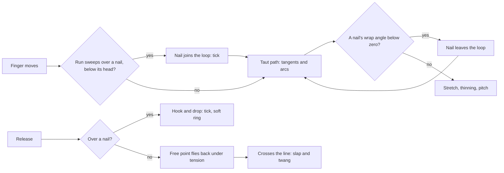

# Geoboard (`geoboard/`)

| | |
|---|---|
| Dutch | Spijkerbord /ˈspɛikərˌbɔrt/ (draft) |
| Motto | A few pegs and an unreasonable number of possibilities. |
| Shelf | Lab, tag "Stimming Lab" |
| Stage | None |
| Series | None |
| Accent | `oklch(0.78 0.16 62)` |
| Sound | Yes |
| Legacy build | No |
| Signed off | No |

## Idea

Idea 24, group D, a fidget: stretch rubber bands across pegs; pluck them to twang. Bean `stimming-7qy1`. Plan: [geoboard.md](../plans/geoboard.md).

## Rules

- One board, four bands, one stretch gesture, one pluck gesture, one slider. No modes.
- The band path is the taut path round its nails: tangent runs and arcs. Wraps, unwraps, hooks and snaps come from that path, not from a script.
- A run's pitch comes from its length and the band's stretch: `C / l * sqrt(λ² - 1/λ)` (neo-Hookean rubber). The same number drives the sound and the slow-motion swing.
- The loop runs only while a band is held, flies back, drops, or rings. A board at rest does no work.

## Direction

- 3D, a high three-quarter view of the whole board from the front, a little to the right. On a tall screen the view is steeper and closer.
- A pale birch plywood block with ply layers on its edges, 5 x 5 steel nails with flat heads, on a plain near-black desk. Red, amber, blue and green satin bands.
- One warm key from the back left throws long nail shadows forward; a cool fill from the front right; a dim room light in the steel.
- True details: a lifted band rises above the nail heads to the finger, so nails near the finger pass under it and nails near its anchors catch it; a band thins and turns paler as it stretches; the band stands on edge as a strip round each nail; a released band whips back, slaps into line and rings; a ringing run shows a soft blur ribbon, densest at its edges, as a fast string does.

## Controls

Bar v3, from the `bar` spec in `initPage()`.

| Slot | Holds |
|---|---|
| Actions | Strum (Space): a hand sweeps across every run, left to right. Reset (R): the bands land back in their first shapes, one after another. |
| Slider | Tension: a slack band (rest loop 96 mm) to a tight band (62 mm); stored as `stimming.geoboard.tension` |
| Settings | Quality (shared) |
| How to play | Drag, release, click, Space, R |

| Gesture | Does |
|---|---|
| Drag a band | A finger hooks it there (or lifts it off a nail) and stretches it |
| Hold a band | The finger lifts it in place |
| Release on a nail | The band hooks the nail and drops onto it with a tick |
| Release in the open | The band snaps back and twangs |
| Click a band | Plucks the run under the pointer |
| Drag across bands | Strums each run the pointer crosses |
| Keys | Space strums; R resets |
| Wheel, pinch, tilt | None |

## Renderer and libraries

| | |
|---|---|
| Stack type | Scene |
| Tier | three.js 0.170, WebGL 2 |
| Libraries | three.js (core, RoundedBoxGeometry, RoomEnvironment, EffectComposer, RenderPass, ShaderPass, UnrealBloomPass, OutputPass); Web Audio for sound |
| Importmap | Word for word |

## Shared modules

| Module | Imports |
|---|---|
| `shared/stim.js` | `initPage`, `whenVisible`, `reduced`, `onReducedChange`, `onQuality`, `pixelRatio`, `audioKit`, `sound`, `stage`, `pageReady` |
| `shared/intro.js` | `intro` |

## Files

| File | Role |
|---|---|
| `index.html` | The page |
| `main.js` | Bar, pointer, Strum and Reset, frame loop, slow-frame step, life cycle |
| `board.js` | The sim, no imports: nails, bands as loops of contacts, taut paths, wrap and unwrap, grab, hook, snap-back, run vibration, events |
| `scene.js` | three.js: desk, plywood board, instanced nails, band strips rebuilt when they move, blur ribbons, finger shade, light, post |
| `sound.js` | Plucked rubber voices through a wooden body, nail ticks, finger taps, slaps, the stretch squeak |

## How it works

- **Contacts.** A band is a closed list of contacts: nails, each with the side it wraps, and at most one finger or one free point. The path between two contacts is the outer or inner tangent of their circles; each contact has an arc.
- **Wrap.** While a finger or a free point moves, each of its two runs sweeps a triangle. A nail inside it, where the run is lower than the nail head, joins the loop on the side it came from. Moves split into steps of 2.5 mm, so no nail is skipped.
- **Unwrap.** Each nail tracks its wrap angle from the nail centres, step by step, so a wrap past half a turn still counts. When it passes back through zero the nail lets go. A band always keeps two nails.
- **Snap-back.** A free point feels both runs' tension, `λ - 1/λ²`, at 240 Hz sub-steps. It stays high while it flies, so it clears the heads. When it crosses the line between its neighbours it leaves, and the merged run is plucked with its speed. A band left on one nail flies back to the nail it came from.
- **Vibration.** Each straight run has six modes (complex amplitudes that rotate and decay). The eye sees them in slow motion, 6 Hz at 200 Hz, as in String harp, with a decay 1.9 times slower than the ear's.

## Frame loop

| State | Rule |
|---|---|
| Lively | A held band, a snap-back, a drop, a ringing run, a queued strum or reset: full frame rate |
| Drifting | None: the toy has no ambient motion |
| Asleep | All bands still: the loop stops |
| Hidden | The loop and the sim clock stop at once |
| Reduced motion | The swing shows at a third of its size and the blur is faint; a released band eases back with no overshoot; strums are softer |

The first frame is a picture: four bands in crossing shapes on the lit board.

Slow frames step down: pixel ratio, then smaller bloom, no multisampling, a 1024 shadow map.

## Sound

Raw Web Audio on `audioKit()`, muted by default, panned across the board.

- **Twang:** one Karplus-Strong voice per pluck, rendered ahead at the run's pitch (55 to 1700 Hz). Rubber damps fast (t60 0.3 to 1.6 s, longer when low). A hard pluck starts up to 6% sharp and glides down, and a soft clip adds the buzz of slapping rubber. At most 14 voices.
- **Body:** every twang passes a small wooden box: a low shelf cut, peaks at 220 and 540 Hz, a soft top.
- **Tick:** a nail catches or lets go of the band. **Hook:** a louder tick and a tap as the band drops onto a nail. **Tap:** the fingertip on a plucked or grabbed band.
- **Slap:** a snap-back whips into line: noise and a falling thump, louder with speed.
- **Squeak:** while a band stretches, band-passed noise chopped at 20 to 75 Hz, as rubber sticks and slips on steel.

## QA

Captures: `docs/qa/geoboard/`. Q1 to Q10 pass on 2026-11-22 (headless Chromium, ANGLE GL, RTX 3070). Q10: 16.7 ms mean and p95 through a pointer stretch (vsync bound).

## Open for Tom

- 3D or flat (3D by default), the board and band colours, the Dutch name (draft Spijkerbord), the icon pick.
