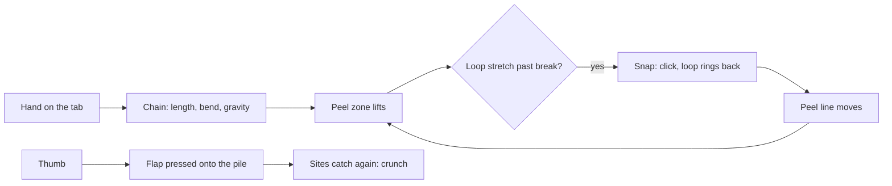

# Hook and loop (`hookloop/`)

| | |
|---|---|
| Dutch | Klittenband /ˈklɪtənˌbɑnt/ (draft) |
| Motto | An excellent sound for undoing things. |
| Shelf | Lab, tag "Stimming Lab" |
| Stage | None |
| Series | None |
| Accent | `oklch(0.66 0.21 31)` |
| Sound | Yes |
| Legacy build | No |
| Signed off | No |

## Idea

Idea 62, group D, a fidget: rip a strap open slowly or fast; the crackle follows your speed. The idea list names it by a brand; the toy is "Hook and loop" everywhere (hard rule 11). Bean `stimming-hfd6`. Plan: [hookloop.md](../plans/hookloop.md).

## Rules

- One strap, one peel gesture, one seal gesture, one slider. No modes.
- The peel and the crackle have one cause: each engagement site snaps when its loop is stretched past its break length, and each snap is one click. The click rate follows the pointer's speed by itself.
- The loop runs only while the strap moves or a fibre springs back. A strap at rest does no work.

## Direction

- 3D, a macro close-up in a low three-quarter view: the strap runs into depth, the tab end near. On a tall screen the camera looks more along the strap.
- A red hook tape on a warm off-white loop tape, on a plain near-black desk. The palette of a real photomicrograph: red monofilament hooks, white loops.
- One low warm key from the back left rakes the pile; a cool fill from the front right. Soft shadows: the lifted flap shades the pile. A shallow focus follows the peel line.
- True details: the pile is clumps of curly loops; the flap shows its dark hook field and its hookless tab; at the peel line loops pull taut up to the hooks, snap, ring and sink back into the pile; a hook shivers when its loop lets go; the red underside tints the pile under an open flap; a peeled flap keeps a set and lies open.

## Controls

Bar v3, from the `bar` spec in `initPage()`.

| Slot | Holds |
|---|---|
| Actions | Rip (Space): the tab swings up round the stitch and the whole strap tears open. Seal (Enter): a thumb runs from the stitch to the tab and presses it shut. |
| Slider | Grip: a worn strap that lets go softly, to a new strap that cracks loud; stored as `stimming.hookloop.grip` |
| Settings | Quality (shared) |
| How to play | Drag, click, Space, Enter |

| Gesture | Does |
|---|---|
| Drag the tab | Peels the strap; the peel line follows the hand |
| Press or drag elsewhere on the strap | A thumb: presses the flap down and seals what lies under it |
| Let go | The flap falls back and lies open with a set curl |
| Keys | Space rips; Enter seals |
| Wheel, pinch, tilt | None |

## Renderer and libraries

| | |
|---|---|
| Stack type | Scene |
| Tier | three.js 0.170, WebGL 2 |
| Libraries | three.js (core, EffectComposer, RenderPass, ShaderPass, UnrealBloomPass, OutputPass); Web Audio for sound |
| Importmap | Word for word |

## Shared modules

| Module | Imports |
|---|---|
| `shared/stim.js` | `initPage`, `whenVisible`, `reduced`, `onReducedChange`, `onQuality`, `pixelRatio`, `audioKit`, `sound`, `stage`, `pageReady` |
| `shared/intro.js` | `intro` |

## Files

| File | Role |
|---|---|
| `index.html` | The page |
| `main.js` | Bar, pointer, Rip and Seal, frame loop, slow-frame step, life cycle |
| `strap.js` | The model, no imports: the hook tape chain, engagement sites, peel, seal, events |
| `scene.js` | three.js: desk, loop tape and pile shells, hook tape rebuilt per frame, hook field shells, instanced fibres, light, focus blur, post |
| `sound.js` | Click bank, rip bed, seal crunch, thumb pat |

## How it works

- **Chain.** The hook tape is 121 nodes, 1.25 mm apart, solved by position-based dynamics at 240 Hz: length, a bend that keeps its centroid, light gravity, the pile as a floor, and the hand on the end node.
- **Sites.** 18 per millimetre of hooked length, each with a break length of 0.9 to 4.6 mm (most short, a few long). An engaged site holds its node by a slack spring. Nodes deeper than nine behind the peel line are anchored, so the tape bends smoothly across a peel zone about 10 mm long.
- **Loose flap.** Let go, and the free part springs back to lie open over its home with a lift that starts flat at the peel line.
- **Seal.** The thumb presses nodes onto the pile; a site re-engages when its node lies home under the thumb.
- **Fibres.** Each site in the peel zone, or springing back, draws one loop (two strands from the pile to the hook) and one hook (a stem and a crook), bent in the vertex shader. Up to 1,400 at once.
- **Focus.** The blur reads depth from the desk plane, not a depth buffer; it eases onto the peel line.

## Frame loop

| State | Rule |
|---|---|
| Lively | A hand, a thumb, Rip or Seal, a falling flap, a springing fibre: full frame rate |
| Drifting | None: the toy has no ambient motion |
| Asleep | The strap at rest: the loop stops |
| Hidden | The loop and the sim clock stop at once |
| Reduced motion | Snapped loops sink with no ring; Rip and Seal run at half speed; the peel answers as usual |

The first frame is a picture: the closed strap lies in the light with its tab curled a little.

Slow frames step down: pixel ratio, then smaller bloom, no multisampling, a 1024 shadow map and no focus blur.

## Sound

Raw Web Audio on `audioKit()`, muted by default, panned with the peel line.

- **Snap:** one click per snapped site from a bank of 18 pre-rendered clicks (a bright noise tick and a short ring). Pitch rises from 0.72 to 1.57 times and level grows with the lift speed; clicks spread over the frame, at most 40 per frame.
- **Rip bed:** band-passed noise, 900 to 3500 Hz with speed; it swells only past 120 snaps a second, so a slow peel is clicks alone.
- **Seal:** soft low crunches, about one per five hooks that catch. **Thumb:** a soft pat when it lands.

Offline render (slow peel, seal, fast rip): slow peel about 250 clicks a second at -32 to -40 dB RMS; seal -35 to -44 dB; fast rip about 5,000 snaps a second at -18 dB RMS; peak -4 dBFS.

## QA (2026-11-22)

Headless Chromium through ANGLE D3D11 (ANGLE GL refused new contexts while other batch sessions held the GPU). Captures: `docs/qa/hookloop/`.

| Check | Result |
|---|---|
| Q1 syntax | `node --check` passes on every module and the menu script |
| Q2 console | Clean at 1280, 375 x 812, 812 x 375, reduced motion and with sound on; the Lab menu is clean with the tile hovered |
| Q3 captures | Blockout, first frame at three sizes, peel, let go, seal, rip, ripped open, reduced motion, intro emblem, Lab tile |
| Q4 idle | 0 frames in 2 s at the first frame, and 0 in 2 s after a let-go |
| Q5 hidden | 0 frames in 2 s, during a rip |
| Q6 reduced | Clean; Space still rips the strap open |
| Q7 bar | 3 controls (Rip, Seal, Grip); 4 How rows |
| Q8 keys | Space rips (81% open); Enter seals (0% open) |
| Q9 sound | The context runs after the gesture and is suspended once the strap settles |
| Q10 frames | 7.9 ms mean, 8.5 ms p95 through a pointer peel, on Tom's PC through ANGLE D3D11 |

## Open for Tom

- 3D or flat: 3D by default. A flat strip shows no lift, no shadow under the flap and no fibres across the gap.
- The strap's colours (red hooks, white loops) and the accent.
- The Dutch name (draft Klittenband, the generic Dutch word).
- Icon pick: A is on the menu until Tom picks (spike `hookloop-1`).
