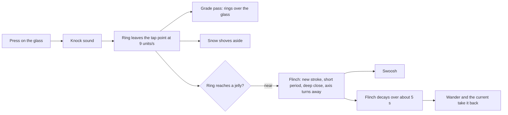

# Jellyfish tank (`jellyfish/`)

| | |
|---|---|
| Dutch | Kwallentank /ˈkʋɑlənˌtɛŋk/ (draft) |
| Motto | None |
| Shelf | Lab, tag "Stimming Lab" |
| Stage | None |
| Series | None |
| Accent | `oklch(0.72 0.13 245)` |
| Sound | Yes |
| Legacy build | No |
| Signed off | No |

## Idea

Idea 80, group F: jellies pulse in a blue-lit tank; tap the glass and they drift away. Bean `stimming-fzcl`. Plan: [jellyfish.md](../plans/jellyfish.md).
Tom, 2026-11-22: "Build it, keep apart". It has no fish, no plants and no gravel, so it stays apart from Aquarium.
Tom, 2026-11-23: "we want differenkind of jellies -- colours -- we want a starfield of small ones -- they have em at the vancouver aquarium".

## Rules

- One tank, one gesture (tap the glass), one slider. No modes.
- The current carries the jellies; their own strokes are slow. A tap is a pressure ring that leaves the glass and reaches each jelly in turn.
- Six large jellies of four kinds, each with its own colour:

| Kind | Bell | Tentacles | Oral arms |
|---|---|---|---|
| Pacific sea nettle (two) | Amber, domed, rust bands, 32 lappets | 24 long, rust | Long, cream |
| Moon jelly (two) | Pale blue, flat, four gonad rings, eight notches | 128 short, fine | Short, frilled |
| Purple-striped jelly | Pale, sixteen purple stripes from a ring | 8 long, dark | Long, pink, frilled |
| Egg-yolk jelly | Clear white round a yellow centre, 16 lobes | 16 bunches of fine pale ones | Short, yellow |

- The starfield: 700 small jellies (420 on a narrow stage) through the whole drum, in soft mixed colours. Each pulses, and its bell flares as it closes: the field twinkles.

## Direction

- 3D, a fixed front view. A round window in a near-black gallery wall, as a round-flow (kreisel) tank in a public aquarium. The drum shows behind the glass: its back wall and its curved side.
- Deep blue water lit from above: light shafts in the upper water, a dark floor, a blue spill on the wall round the window, a lamp glint on the upper left of the acrylic edge.
- True details: a bell glows most where the eye grazes the thin jelly; the gonad rings show from above; the stroke is a quick close and a slow open; the margin closes first; the fringe and arms trail the bell and sway on its beat; far jellies fade into the blue; marine snow rides the current.

## Controls

Bar v3, from the `bar` spec in `initPage()`.

| Slot | Holds |
|---|---|
| Actions | Tap (Space): a knuckle on the glass beside a jelly in the front half |
| Slider | Flow: the speed of the current, 0.08 to 0.63 units a second at the wall; stored as `stimming.jellyfish.flow` |
| Settings | Quality (shared) |
| How to play | Click, Space |

| Gesture | Does |
|---|---|
| Click or tap the glass | A thump: rings run out over the glass, the specks shove aside, near jellies flinch and swim away, the small ones scatter |
| Click on the wall | The same tap at the nearest edge of the glass, softer |
| Drag, hold | Nothing more than the press |
| Keys | Space taps |
| Wheel, pinch, tilt | None |

## Renderer and libraries

| | |
|---|---|
| Stack type | Scene |
| Tier | three.js 0.170, WebGL 2 |
| Libraries | three.js (core, EffectComposer, RenderPass, ShaderPass, UnrealBloomPass, OutputPass); Web Audio for sound |
| Importmap | Word for word |

## Shared modules

| Module | Imports |
|---|---|
| `shared/stim.js` | `initPage`, `whenVisible`, `reduced`, `onReducedChange`, `onQuality`, `pixelRatio`, `audioKit`, `sound`, `stage`, `pageReady` |
| `shared/intro.js` | `intro` |

## Files

| File | Role |
|---|---|
| `index.html` | The page |
| `main.js` | Bar, pointer, Tap, frame loop, sleep, slow-frame step, life cycle |
| `sim.js` | The sim, no imports: the current, the jellies, their strokes, the tap rings, the tentacle and arm chains |
| `scene.js` | three.js: water backdrop, marine snow, bells, fringe and arm ribbons, bloom, the window grade |
| `sound.js` | The pump hum and water bed, the knock, the swooshes |

## How it works

- **Current.** The flow circles the drum axis clockwise, from a quarter speed at the centre to full speed near the wall. Bells and chain points take drag toward it.
- **Stroke.** Contraction over a cycle: 28% to close, the rest to open. Thrust is the closing part of the stroke, along the bell's axis. The bell shape is a squashed sphere cap whose opening angle and width follow the stroke; `bellShape()` in `sim.js` and the bell vertex shader share it.
- **Chains.** Each large jelly has sixteen guide chains round its rim and four arm chains under its centre, 14 points each. Verlet with drag toward the water, a rest-shape spring (stiff at the root, loose at the tip), then fixed segment lengths. Lengths, flare and stiffness come from `SPECIES` in `sim.js`. The renderer spreads each kind's tentacles between the guides, from a float texture; `LOOK` in `scene.js` sets their count, length, width and colour.
- **Bell.** A lathe grid shaped in the vertex shader; each kind has its own dome height and margin lobes. The fragment shader draws the grazing glow and each kind's marks: the moon jelly's gonad horseshoes, canals and sense organs; the nettle's bands; the stripes; the yolk. Lamp light and depth fade on all.
- **Starfield.** The small jellies have no chains: a position, an axis and a pulse each, in flat arrays. They draw as quads turned to the screen; the fragment shader draws a dome side on, a disc from above, and four tentacles a pixel wide. A tap's ring hits each one once as its front passes: it pulses fast and swims away, so the stars scatter from the tap.

## Frame loop

| State | Rule |
|---|---|
| Lively | 1.5 s after input, and while a flinch runs: full frame rate |
| Drifting | Pulses and the current: 30 fps |
| Asleep | 60 s after the last input the motion eases to a stop over 2 s; the loop stops. A press, Space, the slider or a pointer move wakes it. |
| Hidden | The loop and the sim clock stop at once |
| Reduced motion | The bells rest open and nothing drifts. A tap gives near jellies one soft stroke and a nudge; they settle in about 5 s and the loop stops. |

The first frame is a picture: six jellies at set places, the chains already hung in the flow, the starfield spread through the drum.

Slow frames step down: pixel ratio 1, then a smaller bloom buffer.

## Sound

Raw Web Audio on `audioKit()`, muted by default, panned across the window.

- **Bed:** the water's hush (noise through two lowpasses, a slow swell; louder and brighter with Flow), a faint trickle of the inflow at the upper left, the pump's 50 Hz hum with two partials. It runs while the tank is awake and fades when it sleeps.
- **Knock:** a knuckle on thick acrylic: a falling thud, a dulled click, a short panel ring and a low boom in the water. Peak about -9 dBFS.
- **Swoosh:** a soft band-passed rush for each jelly the ring makes flinch, panned with the jelly.

## QA

Captures: `docs/qa/jellyfish/`. Q1 to Q10 pass on 2026-11-23 (headless Chromium, ANGLE GL, RTX 3070). Q4: 30 frames a second drifting, none asleep. Q10: 16.7 ms mean and p95 through three taps (vsync bound); 3.8 ms a frame with the GPU synced, sim included, at 1280 x 800.

## Open for Tom

- 3D with a round window (the default), the presentation, the Dutch name (draft Kwallentank), the icon pick.
- The icons still show a moon jelly; a new round may follow the colours.
