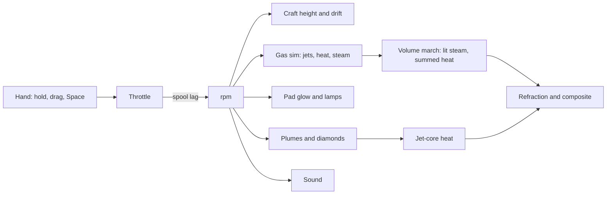

# Jet hover (`jethover/`)

| | |
|---|---|
| Dutch | Zweefjet /ˈzʋeːfˌdʒɛt/ (draft) |
| Motto | None |
| Shelf | Lab, tag "Stimming Lab" |
| Stage | None |
| Series | None |
| Accent | `oklch(0.72 0.13 285)` |
| Sound | Yes |
| Legacy build | No |
| Signed off | No |

## Idea

Idea 366, group C, a cinematic diorama: a VTOL jet hovers on its turbofans with the afterburner lit. Bean `stimming-ay6n`. Plan: [jethover.md](../plans/jethover.md).
Tom sized the full toy XXL. This build is the MVP: one shot, the hover. The plan names the later stages.

## Rules

- One craft, one pad, one shot. No modes, no start-up, no landing.
- The craft is generic: no real aircraft's shape, name, livery or markings (hard rule 11).
- The heat carries the shot: plumes, shock diamonds, shimmer, steam and haze answer the throttle.

## Direction

- 3D, with a fixed low camera at three-quarter front: a diorama with no orbit. The shimmer needs air between the craft and a far horizon.
- Blue hour, just after sunset. The camera looks toward the last light, so the dark craft has a cool rim and a warm underside from its own exhaust.
- An open plain and a damp concrete pad, a far ridge and a row of far lights. The shimmer bends the far lights, the ridge and the slab joints.
- A tall stage pulls the camera back so the whole craft fits.

## Controls

Bar v3, from the `bar` spec in `initPage()`.

| Slot | Holds |
|---|---|
| Actions | Reheat (Space, hold): full throttle |
| Slider | Throttle: the hover setting, 0.2 to 0.75; stored as `stimming.jethover.throttle` |
| Settings | Quality (shared), Reset (the hover setting back to 0.45, the drift to the centre) |
| How to play | Hold, drag, click, Space |

| Gesture | Does |
|---|---|
| Hold | Full reheat: the engines spool up, the craft climbs a little, the plumes lengthen and the steam throws out wider and rises |
| Drag while holding | The craft drifts toward the pointer and yaws a little to face it |
| Click or tap | A short burst of throttle |
| Release | The throttle comes back to the hover setting; the craft settles to the centre |
| Keys | Space held is full reheat |
| Wheel, pinch, tilt | None |

## Renderer and libraries

| | |
|---|---|
| Stack type | Scene |
| Tier | three.js 0.170 |
| Libraries | three (core, EffectComposer, RenderPass, UnrealBloomPass, ShaderPass, OutputPass); Web Audio for sound |
| Kits | K3 volume fluid, ported to WebGL2 in `fluid.js` (marked K3) |
| Importmap | Word for word |

## Shared modules

| Module | Imports |
|---|---|
| `shared/stim.js` | `initPage`, `whenVisible`, `pageReady`, `stage`, `reduced`, `onReducedChange`, `audioKit`, `sound` |
| `shared/intro.js` | `intro` |
| `shared/detail.js` | `detail` |

## Files

| File | Role |
|---|---|
| `index.html` | The page |
| `main.js` | Bar, renderer and passes, engine and craft motion, pointer, frame loop, life cycle |
| `scene.js` | Sky dome, pad shader, the craft from lofts and plates, lights, environment |
| `fx.js` | Plume ribbons, jet-core heat ribbons, the refraction and gas composite, the grade |
| `fluid.js` | K3, the volume fluid, ported to WebGL2: the gas sim and its ray-marched volume |
| `sound.js` | Roar, rumble, hiss, turbine whine, fan buzz and reheat crackle |

## How it works

- **Engine.** The rpm follows the throttle with a lag: about 0.55 s up and 1.1 s down. A press adds a small kick at once, so the gesture answers in the same frame.
- **Craft.** Extra thrust over the hover setting lifts it on a soft spring. The drift is a slower spring toward the pointer, with a roll from the side speed.
- **Plumes.** One view-facing ribbon per nozzle, from the nozzle to the pad, under the gas. A hot throat, a body that runs orange to violet blue, and shock diamonds: rhombs on the axis, spaced wider with more throttle, each dimmer than the one above. The cold lift-fan jet shows only in the gas it drives.
- **Pad.** Damp concrete with slab joints and soot, light from the nozzles and a hot pool under each plume, a wet mirror of the sky and a streak of each plume, then haze.
- **Gas.** K3, the volume fluid of Fire (`shared/fire.js`), ported from WebGPU to WebGL2 fragment passes. A 64 x 28 x 64 grid of 0.375 m cells covers 24 x 10.5 x 24 m over the pad; its y slices lie as tiles in one 448 x 256 texture. Each step: curl, advection with buoyancy, drifting turbulence and vorticity confinement, divergence, 20 Jacobi sweeps, projection, then dye transport. Each jet drives its core down its axis and the hot jets heat it. The pad is a solid floor; the far walls and the roof are open. Steam flashes off the damp pad where a jet lands, and the wall jet tears more off where it runs fast. Steam is warm, so it rises; hot gas rises faster.
- **Volume.** A half-size ray march through the grid, 64 steps, stopped at the craft by the jet-core pass's depth. Fire's method: a velocity-warped lookup, cloud erosion by three noise octaves, light from the hot pools through three self-shadow taps with Beer and multi-scatter terms, a powder term and a Henyey-Greenstein phase, the plumes as a line light so the steam round them glows and the jets read through it, cool sky light from above, interleaved gradient noise on the start, then a light blur.
- **Heat.** The same march sums the heat along each ray, times rising noise cells in world space. The cells are about 20 cm and rise fast; the hot core saturates, so the plumes stay readable. The composite bends the scene along the gradient of that sum, capped at 4 px, so the shimmer sits where the hot gas really is and keeps its perspective. A fine ribbon heat along each jet core adds the near shimmer; the craft writes depth there, so heat behind it does not bend it.
- **Frames.** Scene with MSAA, jet-core heat and depth, gas step and volume, refraction and composite, bloom with a threshold, grade, ACES output.

## Frame loop

| State | Rule |
|---|---|
| Lively | The hand acts, the engine spools, or the craft moves: full frame rate |
| Drifting | The hover: the flame flickers and the gas runs, at 30 fps |
| Asleep | 60 s after the last input, time eases to a stop over 2 s and the loop stops |
| Hidden | The loop and the sim clock stop at once |
| Reduced motion | No flicker, bob, sway, shake or grain while idle; the hover holds still and the loop stops. The throttle still answers. |

The first frame is a picture: five seconds of gas run before it, so the steam is up.
Sound follows the hand: it plays while the throttle is worked and through the spool-down, then fades and the audio context sleeps while the hover drifts on.

Slow frames step down: pixel ratio, then the bloom buffer to a quarter, then the volume march to 36 steps.

## QA (2026-11-22)

Headless Chromium with `--use-angle=gl`. Captures: `docs/qa/jethover/`.

| Check | Result |
|---|---|
| Q1 syntax | `node --check` passes on every module and the menu script |
| Q2 console | Clean at 1280, 375 x 812, 812 x 375, reduced motion and with sound on |
| Q4 idle | 30 frames a second while drifting; 0 frames in 2 s at 65 s after the last input |
| Q5 hidden | 0 frames in 2 s |
| Q6 reduced motion | No frames while idle; 0 frames in 2 s once the craft settles after a gesture |
| Q7 bar | 2 controls (Reheat, Throttle); 4 How rows |
| Q8 keys | Space held runs the engine to 0.95; release spools back to the hover |
| Q9 sound | The context runs during the gesture and is suspended 9 s after release |
| Q10 frames | 16.7 ms median, 16.7 ms p90 during a hold and drag, on Tom's PC through ANGLE GL (vsync bound); about 565 fps unthrottled at 1280 x 800 and 350 at 1920 x 1080, with the gas on |

## Open for Tom

- 3D or flat: 3D by default, a fixed low camera. A flat elevation would lose the air the shimmer bends.
- The name (working name Jet hover), the Dutch name (draft Zweefjet) and the accent.
- Sound follows the hand and fades after the spool-down; a steady hover hum while idle is possible but loud for an office.
- Icon pick: A is on the menu until Tom picks (spike `jethover-1`).
