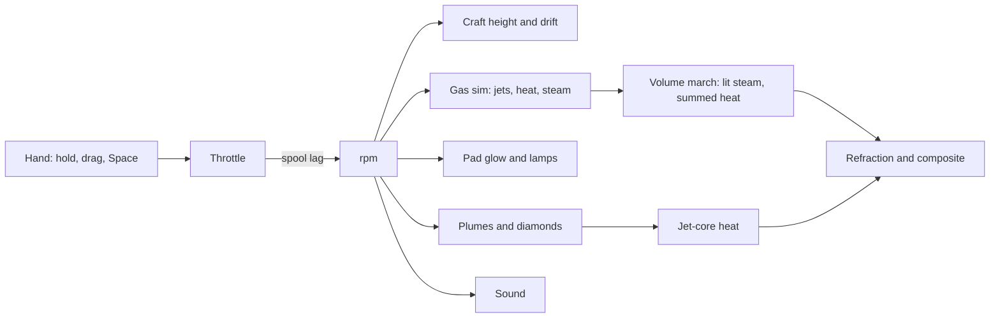

# Jet hover (`jethover/`)

| | |
|---|---|
| Dutch | Zweefjet /ˈzʋeːfˌdʒɛt/ (draft) |
| Motto | None |
| Shelf | Lab, tag "Stimming Lab" |
| Stage | None |
| Series | None |
| Accent | `oklch(0.72 0.13 285)` |
| Sound | Yes |
| Legacy build | No |
| Signed off | No |

## Idea

Idea 366, group C, a cinematic diorama: a VTOL jet hovers on its turbofans with the afterburner lit. Bean `stimming-ay6n`. Plan: [jethover.md](../plans/jethover.md).
Tom sized the full toy XXL. This build is the MVP: one shot, the hover. The plan names the later stages.

## Rules

- One craft, one pad, one shot. No modes, no start-up, no landing.
- The craft is generic: no real aircraft's shape, name, livery or markings (hard rule 11).
- The heat carries the shot: plumes, shock diamonds, shimmer, steam and haze answer the throttle.

## Direction

- 3D, a fixed long-lens shot as Villeneuve frames scale (Tom, 2026-11-23: "more villeneuveian the camera and positioning"). The eye stands 1.7 m up, 150 m out on the apron, with a 9 degree lens.
- The craft hovers nose on, a little off the axis, small in the middle of the frame. The two plumes stand side by side.
- Behind it, three ranges at true scale sink into the haze: low hills at 2.6 km, table mountains at 7 km, a massif at 18 km. A row of far lights runs at the foot of the hills.
- The long lens is where heat haze shows in real life: the hot gas bends the far ranges and the lights.
- Four times of day (Tom, 2026-11-23: "lets add ToD -- 4 times of day"). Dusk is the default: blue hour, just after sunset, the camera toward the last light, the craft warm underneath from its own exhaust. Dawn: a peach glow behind the ranges, morning mist. Day: a pale, dusty haze, the ranges faint. Night: stars, the far lights bright, the exhaust the only strong light.
- A wet concrete apron runs to 260 m. Wet patches mirror the far country and the plumes.
- A tall stage widens the lens to 17 degrees and backs off until 30 m of width fits.
- A tight lens (L) sits beside the wide shot, to judge the heat shimmer against the far country (Tom, 2026-11-23: "Yes, tight lens"). It stays at the same place and narrows to 10 m across at the plumes (6 m on a tall stage), aimed at the pad between them. The frame holds the two plumes, the pad blast, and the hills, mesas and far lights behind them. The wide shot stays the default: it is the Villeneuve shot Tom asked for; the tight one is a test view. The pick is stored as `stimming.jethover.lens`.

## Controls

Bar v3, from the `bar` spec in `initPage()`.

| Slot | Holds |
|---|---|
| Choice | Time of day: Dawn, Day, Dusk, Night (keys 1 to 4); stored as `stimming.jethover.time` |
| Actions | Reheat (Space, hold): full throttle; Lens (L): wide or tight |
| Slider | Throttle: the hover setting, 0.2 to 0.75; stored as `stimming.jethover.throttle` |
| Settings | Quality (shared), Reset (the hover setting back to 0.45, the drift to the centre) |
| How to play | Hold, drag, click, Space |

| Gesture | Does |
|---|---|
| Hold | Full reheat: the engines spool up, the craft climbs a little, the plumes lengthen and the steam throws out wider and rises |
| Drag while holding | The craft drifts toward the pointer and yaws a little to face it |
| Click or tap | A short burst of throttle |
| Release | The throttle comes back to the hover setting; the craft settles to the centre |
| Keys | Space held is full reheat; 1 to 4 pick the time of day; L switches the lens |
| Wheel, pinch, tilt | None |

## Renderer and libraries

| | |
|---|---|
| Stack type | Compute |
| Tier | three.js 0.186.1 WebGPU (`WebGPURenderer`, TSL), WebGPU backend only (Tom, 2026-11-23: "truster will become webgpu") |
| Libraries | `three/webgpu`, `three/tsl`, `BloomNode`, `GaussianBlurNode`, `curlNoise`; Web Audio for sound |
| Kits | K3: `gas.js` is a copy of `shared/fire.js` with Jet hover's additions marked |
| Importmap | Differs: three 0.186.1 entries only, word for word from `galaxy/index.html` |

## Shared modules

| Module | Imports |
|---|---|
| `shared/stim.js` | `initPage`, `whenVisible`, `pageReady`, `stage`, `reduced`, `onReducedChange`, `audioKit`, `sound` |
| `shared/intro.js` | `intro` |
| `shared/detail.js` | `detail` |
| `shared/daytime.js` | `HOURS`, `dayClock` |

## Files

| File | Role |
|---|---|
| `index.html` | The page |
| `main.js` | Bar, renderer and passes, engine and craft motion, pointer, frame loop, life cycle |
| `scene.js` | Sky and far country, the apron, the craft from lofts and plates, lights, the four times of day |
| `fx.js` | Plume ribbons; the post chain: heat bend, gas over the scene, bloom, the grade |
| `gas.js` | K3, Fire's fluid and volume (copy of `shared/fire.js`), with jets, a solid floor, steam, sky light and a heat volume |
| `sound.js` | Roar, rumble, hiss, turbine whine, fan buzz and reheat crackle |

## How it works

- **Engine.** The rpm follows the throttle with a lag: about 0.55 s up and 1.1 s down. A press adds a small kick at once, so the gesture answers in the same frame.
- **Craft.** Extra thrust over the hover setting lifts it on a soft spring. The drift is a slower spring toward the pointer, with a roll from the side speed.
- **Plumes.** One view-facing ribbon per nozzle, from the nozzle to the pad, under the gas. A hot throat, a body that runs orange to violet blue, and shock diamonds: rhombs on the axis, spaced wider with more throttle, each dimmer than the one above. The cold lift-fan jet shows only in the gas it drives.
- **Pad.** Damp concrete with slab joints and soot, light from the nozzles and a hot pool under each plume, a wet mirror of the sky and a streak of each plume, then haze.
- **Gas.** Fire's fluid (`shared/fire.js`), copied into `gas.js`. A 112 x 56 x 112 grid of 0.25 m cells covers 28 x 14 x 28 m over the pad. Compute passes each step: curl, advection with buoyancy, curl-noise turbulence and vorticity confinement, divergence, 12 Jacobi sweeps, projection, dye transport. Jet hover adds: each jet drives its core down its axis; the floor is solid. The exhaust strikes the floor and smokes it, then turns flat: a thin sheet runs out radially to 4.5 m, then runs free, and its shear rolls it into billows (Tom, 2026-11-23: "the billows also come from the jet"). The hot jets heat their cores, and steam flashes off the damp floor in a ring round each landing point. The gas clock runs at 0.55 of real time, so the billows roll slowly, as Fire's smoke does (Tom, 2026-11-23: "Slower, like Fire").
- **Volume.** Fire's lit volume, unchanged in method: a velocity-warped lookup, simplex detail, light from the lamps through a short self-shadow march with Beer, multi-scatter and powder terms, a Henyey-Greenstein phase. Flame light comes from heat through Fire's flame ramp, so the exhaust and the hot gas at the pad glow by the same shader. Jet hover adds a flat flame gain, a glow that fades with the gas's age, and blue-hour sky light on the steam. The march stops behind the craft. It draws at half size and is blurred a little.
- **Heat.** A twin volume sums heat times rising noise cells along each ray, at half size. The post chain bends the frame along the gradient of that sum, so the shimmer sits where the hot gas is. In the wide shot the bend caps at 3 px. In the tight lens the bend grows with the square root of the zoom, the cap with its 0.75 power (about 8 px), and the gradient taps widen with the zoom, so the bend stays smooth. The tight lens draws the gas and heat at three quarters size.
- **Time of day.** Four keys in `scene.js` at the hours of `HOURS`: dawn 6.2, day 12.5, dusk 19.3, night 23. Each key sets the sky (zenith, horizon, the band and halo toward the sun, stars), the ranges, the far lights, the apron's sky and sun light, the haze, the hemisphere and rim lights, the exposure, the grade's key, the sky light on the gas and the plume gain. A pick eases the hour over about 2 s with `dayClock`; between two keys every value blends.
- **Frames.** Scene; gas and heat volumes at half size; heat bend; gas over the scene; bloom; ACES; the grade: colour pulled toward one cool key, highs to cream, a vignette, grain and lifted blacks, after Railgun's Villeneuve print.

## Frame loop

| State | Rule |
|---|---|
| Lively | The hand acts, the engine spools, the craft moves, the hour eases, or the lens zooms: full frame rate |
| Drifting | The hover: the flame flickers and the gas runs, at 30 fps |
| Asleep | 60 s after the last input, time eases to a stop over 2 s and the loop stops |
| Hidden | The loop and the sim clock stop at once |
| Reduced motion | No flicker, bob, sway, shake or grain while idle; the hover holds still and the loop stops. The throttle still answers. |

The first frame is a picture: five seconds of gas run before it, so the steam is up.
Sound follows the hand: it plays while the throttle is worked and through the spool-down, then fades and the audio context sleeps while the hover drifts on.

Slow frames step down: pixel ratio, then the volume march from 72 to 44 steps.

## QA (2026-11-23, WebGPU build)

Headless Edge, WebGPU on D3D12 (`--enable-unsafe-webgpu`), on Tom's PC. Captures 11 to 20: `docs/qa/jethover/`; 15 to 19 show the four times of day, 20 the jet's billows, 21 to 23 the tight lens. Captures 01 to 10 show the first WebGL build.

| Check | Result |
|---|---|
| Q1 syntax | `node --check` passes on every module |
| Q2 console | Clean at 1280, 375 x 812, 812 x 375, reduced motion and with sound on |
| Q4 idle | 32 frames a second while drifting; 0 frames in 2 s at 65 s after the last input |
| Q5 hidden | 0 frames in 2 s |
| Q6 reduced motion | No frames while idle; 0 frames in 2 s once the craft settles after a gesture |
| Q8 keys | Space held runs the engine to 0.95; release spools back to the hover |
| Q9 sound | The context runs during the gesture and is suspended 9 s after release |
| Q10 frames | 7.9 ms median, 8.1 ms p90 during a hold and drag at 1280 x 800; 7.8 ms and 8.1 ms with the tight lens |

The renderer's own frame loop is stopped; the page ticks the node clock before each render.

## Open for Tom

- The shot: 9 degree lens from 150 m; the craft nose on. A closer or wider framing is one number each.
- The tight lens: 10 m across at the plumes (`TIGHT_W` in `main.js`). On reheat the steam fills the tight frame; the hover setting shows the most background.
- The four times of day are a first pass: each is one key in `scene.js`.
- The gas speed: 0.55 of real time (`GAS_K` in `main.js`). Slower or faster is one number.
- No WebGPU, no toy: the page shows one line. A WebGL Classic build could stay as `legacy.html` if Tom wants one.
- The name (working name Jet hover), the Dutch name (draft Zweefjet) and the accent.
- Sound follows the hand and fades after the spool-down; a steady hover hum while idle is possible but loud for an office.
- Icon pick: A is on the menu until Tom picks (spike `jethover-1`).
