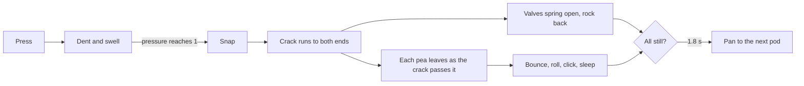

# Pea pod (`peapod/`)

| | |
|---|---|
| Dutch | Peul /pøːl/ (draft) |
| Motto | None |
| Shelf | Lab, tag "Stimming Lab" |
| Stage | None |
| Series | None |
| Accent | `oklch(0.82 0.17 132)` |
| Sound | Yes |
| Legacy build | No |
| Signed off | No |

## Idea

Idea 67, group D: squeeze a pod; it splits along its seam, and the peas pop out and roll. Bean `stimming-us9s`. Plan: [peapod.md](../plans/peapod.md).

## Rules

- One pod at a time, one gesture, one slider. No modes.
- The pod shape comes from a few damped springs, not a soft-body solver. The snap is the same each time; only the press point and the Spring slider change it.
- The loop runs only while something moves. A closed pod at rest does no work.

## Direction

- 3D, a high three-quarter view of one pod on a dark oiled table.
- One low warm key light from behind on the left: long soft shadows, light through the thin green tissue at the edges, wet glints that bloom. A cool fill from the right keeps the far side of each pea.
- True details: the skin swells over each pea; a keel runs along each seam; the seam pales under strain; the crack runs from the dent to both ends; the peas leave in turn, left and right, as they hung; each pea shows a pale hilum scar that turns as it rolls; a fine mist of juice leaves the seam at the snap.
- A new pod comes in by a pan along the table; it drops the last few centimetres and settles.

## Controls

Bar v3, from the `bar` spec in `initPage()`.

| Slot | Holds |
|---|---|
| Actions | Squeeze (Space, hold): squeezes the middle of the pod |
| Slider | Spring: from a fresh pod that springs back to a narrow gape, to a dry pod that lies flat open, twists and flings its peas; stored as `stimming.peapod.spring` |
| Settings | Quality (shared) |
| How to play | Hold, drag, click, Space |

| Gesture | Does |
|---|---|
| Hold | Squeezes the pod where it is nearest the pointer, until the seam snaps (about 0.9 s) |
| Drag | Moves the dent along the pod |
| Click or tap | A short pinch; quick pinches add up to a snap |
| Press after the split | Brings the next pod at once |
| Keys | Space held squeezes the middle |
| Wheel, pinch, tilt | None |

## Renderer and libraries

| | |
|---|---|
| Stack type | Scene |
| Tier | three.js 0.170, WebGL 2 |
| Libraries | three.js (core, EffectComposer, RenderPass, ShaderPass, UnrealBloomPass, OutputPass); Web Audio for sound |
| Importmap | Word for word |

## Shared modules

| Module | Imports |
|---|---|
| `shared/stim.js` | `initPage`, `whenVisible`, `reduced`, `onReducedChange`, `onQuality`, `pixelRatio`, `audioKit`, `sound`, `stage`, `pageReady` |
| `shared/intro.js` | `intro` |

## Files

| File | Role |
|---|---|
| `index.html` | The page |
| `main.js` | Bar, pointer, frame loop, slow-frame step, life cycle |
| `pod.js` | The simulation, no imports: pod shape, squeeze, crack, valves, peas, mist, pan |
| `scene.js` | three.js: table, light, valve shells rebuilt per frame, calyx, instanced peas, mist, post |
| `sound.js` | Squish, creak and squeak, snap, valve thud, pea ticks, tocks and clicks, roll bed, pan, landing |

## How it works

- **Squeeze.** Holding raises the pressure by 1 in 0.95 s; it leaks at 0.32 per second when released, and each press adds 0.1. The dent is a spring that follows the pressure: the top seam sinks under the pointer and the sides bulge.
- **Valves.** Each valve is a half shell (skin, lining, two cut rims) that turns about the back seam. Its angle is a damped spring with a kick at the snap; flat on its back it meets the table and rocks back. Twist and curl are springs too, and grow with Spring. A slice turns only after the crack has passed it.
- **Peas.** Spheres with a little squash. Gravity, a bounce on the table, friction that turns slip into roll, rolling drag, pea to pea contact by volume, and the open valves as low humps. A pea that lies still for 0.25 s sleeps.
- **Shell.** 72 slices by 15 points per half. The rebuild skips a frame when no input number changed.

## Frame loop

| State | Rule |
|---|---|
| Lively | A squeeze, the open, peas in motion, the pan: full frame rate |
| Drifting | None: the toy has no ambient motion |
| Asleep | The new pod lies still after the pan: the loop stops |
| Hidden | The loop and the sim clock stop at once |
| Reduced motion | The squeeze answers as usual; the open plays at half speed with no twist; the peas leave gently; the pan is a cut through black |

The first frame is a picture: the pod lies in the light with three loose peas from an earlier pod.

Slow frames step down: pixel ratio, then smaller bloom, no multisampling and a 1024 shadow map.

## QA (2026-11-22)

Headless Chromium with `--use-angle=gl`. Captures: `docs/qa/peapod/`.

| Check | Result |
|---|---|
| Q1 syntax | `node --check` passes on every module and the menu scripts |
| Q2 console | Clean at 1280, 375 x 812, 812 x 375, reduced motion and with sound on; the Lab menu is clean with the tile hovered |
| Q3 captures | Blockout, first frame at three sizes, squeeze, snap, open, peas in flight, rest, Spring 1 twist, reduced motion, intro emblem, Lab tile |
| Q4 idle | 0 frames in 2 s while the pod waits, and 0 in 2 s after the pan |
| Q5 hidden | 0 frames in 2 s, with the pod open |
| Q6 reduced | Clean; the hold still snaps; the open is gentler |
| Q7 bar | 2 controls (Squeeze, Spring); 4 How rows |
| Q8 keys | Space held squeezes the middle and snaps the pod |
| Q9 sound | The context runs after the gesture and is suspended once the toy settles |
| Q10 frames | 16.7 ms mean, 16.8 ms p95 through the snap, on Tom's PC through ANGLE GL |

Offline render of one squeeze, snap and scatter: creak peak -24 dBFS, snap peak -5.7 dBFS, peas peak -12.6 dBFS.

## Open for Tom

- 3D or flat: 3D by default. Flat would lose the curl of the valves and the roll of the peas.
- The Dutch name (draft Peul) and the accent.
- Icon pick: A is on the menu until Tom picks (spike `peapod-1`).
- Kit K4 is not used: a cloth shell needs shape matching to hold a pod form. Say if the plan should keep K4 for this toy.
