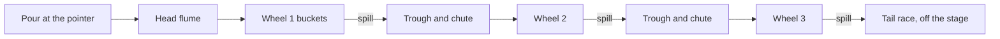

# Water wheel (`waterwheel/`)

| | |
|---|---|
| Dutch | Waterrad /ˈʋaːtərˌrɑt/ (draft) |
| Motto | Going round on the river's time. |
| Shelf | Lab, tag "Stimming Lab" |
| Stage | None |
| Series | None |
| Accent | `oklch(0.8 0.11 70)` |
| Sound | Yes |
| Legacy build | No |
| Signed off | No |

## Idea

Idea 73, group E: pour water; it runs down the flumes and turns a chain of wheels. Bean `stimming-2s2a`. Plan: [waterwheel.md](../plans/waterwheel.md), cut from L to M.

## Rules

- One pour, three overshot wheels, nothing else. No modes.
- Water is ballistic particles. Buckets hold a number, not particles. No fluid solver.
- The loop runs only while water moves or a wheel turns.

## Direction

- Flat side elevation: a section through the race, so the whole chain and the water in each bucket show.
- A low evening sun stands behind the top wheel and shows between its arms. The wheels and the bank are dark with warm rims; the water glows where the sun backlights it.
- Wide stage: a staircase of three wheels down to the right. Tall stage: a zigzag down.
- The wheels go from large to small, so the chain turns faster downhill.

## Controls

Bar v3, from the `bar` spec in `initPage()`.

| Slot | Holds |
|---|---|
| Actions | Pour (Space, hold): pours into the head flume |
| Slider | Flow: how hard the pour runs; stored as `stimming.waterwheel.flow` |
| Settings | Quality (shared), Reset (empties the buckets and stops the wheels) |
| How to play | Hold, drag, click, Space |

| Gesture | Does |
|---|---|
| Hold | Pours a stream from the top of the stage at the pointer |
| Drag | Moves the stream |
| Click or tap | Pours a short splash |
| Keys | Space held pours into the head flume |
| Wheel, pinch, tilt | None |

## Renderer and libraries

| | |
|---|---|
| Stack type | Shader |
| Tier | Raw WebGL2 |
| Libraries | None from the importmap; Web Audio for sound |
| Importmap | Word for word |

## Shared modules

| Module | Imports |
|---|---|
| `shared/stim.js` | `initPage`, `whenVisible`, `pageReady`, `stage`, `reduced`, `onReducedChange`, `audioKit`, `sound` |
| `shared/intro.js` | `intro` |
| `shared/gl.js` | `TRI_VS`, `program`, `linked`, `target`, `free`, `bind`, `tri`, `onContextLoss` |
| `shared/glow.js` | `bloomChain` |
| `shared/detail.js` | `detail` |

## Files

| File | Role |
|---|---|
| `index.html` | The page |
| `main.js` | Bar, pointer, frame loop, life cycle, prewarm |
| `sim.js` | Layout of the race; particles, floors, buckets, wheel motion |
| `render.js` | The static layer (Canvas 2D, once per size) and each frame's passes |
| `shaders.js` | Base sky, wheel, splat, water, sun shafts, grade |
| `sound.js` | Pour, run, splash, bubbles, knocks and creaks |

## How it works

- **Floors.** Each flume and trough is a polyline, solid from above. Water on a floor runs at a set speed, faster on a steep chute. The last half metre before each lip runs level, so the jet leaves slow and lands just past the top.
- **Buckets.** A bucket takes a particle while it has room. Its room is full from just before the top to past horizontal, then falls to zero on the way down. Water above the room pours out of the mouth with the rim's speed.
- **Wheels.** Torque is the bucket water times its lever arm. Friction has a viscous part and a dry part; the dry part holds a slow wheel still.
- **Frames.** The base (sky and static layer) is blitted, wheels draw as shapes over it, water splats into a half-size density field, the water pass shades it with refraction and backlight, spray adds glints, then bloom, sun shafts from the bloom, and the grade.

## Frame loop

| State | Rule |
|---|---|
| Lively | Water in flight, a pour, or a turning wheel: full frame rate |
| Drifting | None: the toy has no ambient motion |
| Asleep | The last drop gone and the last wheel stopped: the loop stops |
| Hidden | The loop and the sim clock stop at once |
| Reduced motion | No grain motion and calmer spray; the pour and the wheels still answer |

The first frame is a picture: a five-second pour runs before it, so water is in the flumes and the buckets. The run-down plays after the intro.

Slow frames step down: pixel ratio, then the density field to a quarter and three bloom levels, then the particle cap to 1,600.

## QA (2026-11-22)

Headless Chromium with `--use-angle=gl`. Captures: `docs/qa/waterwheel/`.

| Check | Result |
|---|---|
| Q1 syntax | `node --check` passes on every module and the menu script |
| Q2 console | Clean at 1280, 375 x 812, 812 x 375, reduced motion and with sound on |
| Q4 idle | 0 frames in 2 s after the toy settles (about 34 s after a long pour stops) |
| Q5 hidden | 0 frames in 2 s, with water in flight |
| Q7 bar | 2 controls (Pour, Flow); 4 How rows |
| Q8 keys | Space held pours into the head flume; release stops it |
| Q9 sound | The context runs after the gesture and is suspended once the toy settles |
| Q10 frames | 16.7 ms mean, 16.8 ms p95 during a pour, on Tom's PC through ANGLE GL |

## Open for Tom

- 3D or flat: flat side elevation by default. A 3D wheel would be a new plan.
- The Dutch name (draft Waterrad) and the accent.
- Icon pick: A is on the menu until Tom picks (spike `waterwheel-1`).
