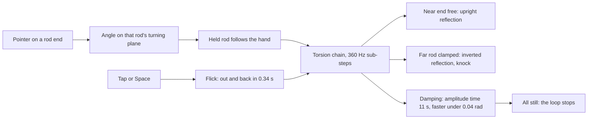

# Wave machine (`wavemachine/`)

| | |
|---|---|
| Dutch | Golfmachine /ˈɣɔlfmɑˌʃinə/ (draft) |
| Motto | None |
| Shelf | Lab, tag "Stimming Lab" |
| Stage | None |
| Series | None |
| Accent | `oklch(0.78 0.13 78)` |
| Sound | Yes |
| Legacy build | No |
| Signed off | No |

## Idea

Idea 128, group A, a lab demonstration: flick a row of rods; the wave runs out and bounces back. Bean `stimming-40u6`. Plan: [wavemachine.md](../plans/wavemachine.md).

## Rules

- One machine, one turn gesture, one flick, one slider. No modes.
- Every rod is one cell of a torsion chain. The wave, its speed, its reflection and its decay come from the chain, not from a script.
- The near end turns free. The clamp holds the far rod, so a pulse comes back upside down.
- The loop runs only while a rod moves or is held. A machine at rest does no work.

## Direction

- 3D, a high three-quarter view along the machine from its near end, front left. On a tall screen the line runs away up the frame.
- 96 chromed steel rods, 46 cm, 18 mm apart, welded at their middles across a flat steel band. Brass weights on the rod ends. A dark anodised rail with five posts and small bearings; the clamp block on the far stand.
- A black epoxy lab bench with a soft sheen. One warm lamp behind the middle of the machine: its pool fades at the ends, and a faint haze shows its beam. A cool rim from the front right; a dim room light in the chrome.
- True details: the rod ends trace two sines, one above the wire and one below; the rods' shadows comb on the bench with the wave; the flat wire's highlight twists with the rods; heavier weights grow on the stage and slow the wave; a pulse from a middle rod splits into two that run apart; two pulses pass through each other.

## Controls

Bar v3, from the `bar` spec in `initPage()`.

| Slot | Holds |
|---|---|
| Actions | Flick (Space): the first rod swings out and back once. Still (R): a hand along the line brings it to rest in about a second. |
| Slider | Weights: small to large brass weights; the wave runs 58 to 32 rods a second. Stored as `stimming.wavemachine.weights` |
| Settings | Quality (shared) |
| How to play | Drag, click, Space, R |

| Gesture | Does |
|---|---|
| Drag a rod end | The rod turns on the wire with the pointer; its neighbours follow through the wire |
| Hold a rod | The rod waits in the hand |
| Release | The rod lets go with its spin |
| Click or tap a rod | The rod flicks out and back: a clean pulse, two from a rod in the middle |
| Keys | Space flicks the first rod; R stills the line |
| Wheel, pinch, tilt | None |

## Renderer and libraries

| | |
|---|---|
| Stack type | Scene |
| Tier | three.js 0.170, WebGL 2 |
| Libraries | three.js (core, RoomEnvironment, EffectComposer, RenderPass, ShaderPass, UnrealBloomPass, OutputPass); Web Audio for sound |
| Importmap | Word for word |

## Shared modules

| Module | Imports |
|---|---|
| `shared/stim.js` | `initPage`, `whenVisible`, `reduced`, `onReducedChange`, `onQuality`, `pixelRatio`, `audioKit`, `sound`, `stage`, `pageReady` |
| `shared/intro.js` | `intro` |

## Files

| File | Role |
|---|---|
| `index.html` | The page |
| `main.js` | Bar, pointer, Flick and Still, frame loop, slow-frame step, life cycle |
| `sim.js` | The torsion chain, no imports: angles, spins, the hand, flicks, the clamp, damping, events |
| `scene.js` | three.js: bench, rail, posts, clamp, instanced rods and weights, the twisted wire ribbon, lamp and beam haze, post, picking |
| `sound.js` | The swish of the moving rods, rod rings, whips, finger ticks, the clamp knock |

## How it works

- **Chain.** `θ''ᵢ = s² (θᵢ₊₁ − 2θᵢ + θᵢ₋₁) − γ θ'ᵢ + ν (θ'ᵢ₊₁ − 2θ'ᵢ + θ'ᵢ₋₁)`, with `s` the wave speed in rods a second. Semi-implicit Euler at 360 Hz. The `ν` term damps only grid-scale ripple.
- **Ends.** Rod 0 has one neighbour, so it turns free. The last rod stays at zero: the clamp.
- **Hand.** The pointer ray meets the plane the rod turns in; its angle about the wire is the target. The grip side (near or far half) is kept, so the rod does not jump. The held rod follows with a 18 ms lag, which takes out pointer jitter.
- **Flick.** A tap drives the rod through `a sin²(πt / 0.34 s)`: out and back with no jerk, so the pulse leaves clean, about 13 rods wide.
- **Weights.** Larger weights mean more inertia: `s = 40 √(2.1 / (1 + 2.2 w))`. The brass caps grow with them.

## Frame loop

| State | Rule |
|---|---|
| Lively | A held rod, a flick, any rod in motion: full frame rate |
| Drifting | None: the toy has no ambient motion |
| Asleep | Every rod under 0.0015 rad and still: the loop stops |
| Hidden | The loop and the sim clock stop at once |
| Reduced motion | Flicks are smaller (0.32 rad, not 0.52) |

The first frame is a picture: one pulse already halfway down the line. After the intro it runs on, reflects and dies.

Slow frames step down: pixel ratio, then smaller bloom, no multisampling, a 1024 shadow map.

## Sound

Raw Web Audio on `audioKit()`, muted by default, panned by place on the screen.

- **Swish:** air off the moving rods: band-passed noise whose level follows the line's energy and whose brightness rises with it. It pans with the centre of the motion. A low rumble joins under a big wave.
- **Ring:** a flicked or released rod rings in free bending modes (partials 1, 2.76, 5.40). Heavier weights ring lower.
- **Whip:** a flick cuts the air: a band of noise that sweeps up and down.
- **Tick:** the fingertip on a steel rod.
- **Knock:** a strong pulse reaches the clamp: a dull thud and a short steel ring, on the right of the picture.

## QA

Captures: `docs/qa/wavemachine/`. Q1 to Q10 pass on 2026-11-23 (headless Chromium, ANGLE GL, RTX 3070). Q10: 16.7 ms median and p95 while a pulse runs (vsync bound). The sim alone: a 0.52 rad flick comes to rest after about 28 s.

## Open for Tom

- 3D or flat (3D by default), the clamped far end, the Dutch name (draft Golfmachine), the icon pick.
